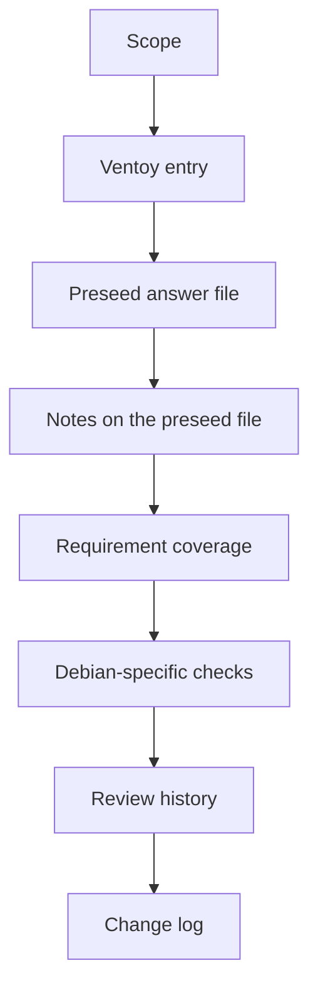

# Ventoy Automated Configuration for Debian 13 Server



Some renderers, including GitHub, disable clicks inside Mermaid charts. The same sections are linked here: [Scope](#scope), [Ventoy entry](#ventoy-entry), [Preseed answer file](#preseed-answer-file), [Notes on the preseed file](#notes-on-the-preseed-file), [Requirement coverage](#requirement-coverage), [Debian-specific checks](#debian-specific-checks), [Review history](#review-history), [Change log](#change-log), [References](#references).

## Scope

- Debian 13 "trixie", the current Debian stable release <a id="cite-debian-example-preseed"></a>([Debian Project, n.d.-c](#ref-debian-example-preseed)), installed from the netinst ISO with the Debian Installer and a preseed answer file.
- The result is the raw node defined in `ventoy-raw-node-baseline-v0.2.0.md`. That document holds the requirements (RN-01 to RN-11), the canonical SSH and firewall files, password hash generation, the general acceptance checks and the handover to Ansible. This document holds only what is specific to Debian 13.
- The default hostname is `debian-server`.
- A Debian 13 Incus host variant is planned. It will become a second answer file for the same ISO once its partitioning is automated. Until then, the Incus host role is given by Ansible.

## Ventoy entry

Place the ISO and answer file as shown in the baseline document's directory structure:

```text
/ISO/debian/13/debian-13.7.0-amd64-netinst.iso
/ventoy/answer-files/debian-13-preseed.cfg
```

The matching `ventoy.json` entry:

```json
{
  "image": "/ISO/debian/13/debian-13.7.0-amd64-netinst.iso",
  "template": "/ventoy/answer-files/debian-13-preseed.cfg"
}
```

Replace `N` with the point release you download.

## Preseed answer file

File: `/ventoy/answer-files/debian-13-preseed.cfg`

A preconfiguration file should begin with `#_preseed_V1`, and its syntax can be checked before use with `debconf-set-selections -c` <a id="cite-debian-b3"></a>([Debian Project, n.d.-a](#ref-debian-b3)).

Replace `ROOT_PASSWORD_HASH`, `INITIAL_PASSWORD_HASH` and `YOUR_SSH_PUBLIC_KEY` as described in the baseline document. The hashes are written without quotes. The public key stays inside the single quotes of its `echo` command.

[ventoy-raw-node-baseline-v0.2.0.md](../ventoy-raw-node-baseline-v0.2.0.md#password-hashes)

Prepare your hashes

```text
#_preseed_V1

### Localization

d-i debian-installer/locale string en_CA.UTF-8
d-i keyboard-configuration/xkb-keymap select us

### Network

d-i netcfg/choose_interface select auto
d-i netcfg/get_hostname string debian-server
d-i netcfg/get_domain string home.arpa
d-i netcfg/hostname string debian-server

### Mirror

d-i mirror/country string manual
d-i mirror/http/hostname string deb.debian.org
d-i mirror/http/directory string /debian
d-i mirror/http/proxy string

### Clock and time zone

d-i clock-setup/utc boolean true
d-i time/zone string America/Toronto
d-i clock-setup/ntp boolean true

### Root account

d-i passwd/root-login boolean true
d-i passwd/root-password-crypted password ROOT_PASSWORD_HASH

### Initial user

d-i passwd/make-user boolean true
d-i passwd/user-fullname string Initial User
d-i passwd/username string initial
d-i passwd/user-password-crypted password INITIAL_PASSWORD_HASH

### Partitioning

# Deliberately not preseeded. The partitioner stops for manual confirmation.

### Package selection

tasksel tasksel/first multiselect standard, ssh-server
d-i pkgsel/include string sudo nftables python3
d-i pkgsel/upgrade select none
d-i pkgsel/update-policy select none
popularity-contest popularity-contest/participate boolean false

### Boot loader

d-i grub-installer/only_debian boolean true

### Post-install configuration

d-i preseed/late_command string \
    in-target usermod -aG sudo initial; \
    in-target install -d -m 0700 -o initial -g initial /home/initial/.ssh; \
    echo 'YOUR_SSH_PUBLIC_KEY' > /target/home/initial/.ssh/authorized_keys; \
    in-target chown initial:initial /home/initial/.ssh/authorized_keys; \
    in-target chmod 0600 /home/initial/.ssh/authorized_keys; \
    echo 'UGVybWl0Um9vdExvZ2luIG5vClB1YmtleUF1dGhlbnRpY2F0aW9uIHllcwpQYXNzd29yZEF1dGhlbnRpY2F0aW9uIHllcwpLYmRJbnRlcmFjdGl2ZUF1dGhlbnRpY2F0aW9uIG5vClVzZVBBTSB5ZXMK' > /target/tmp/10-local-auth.conf.b64; \
    in-target sh -c 'base64 -d /tmp/10-local-auth.conf.b64 > /etc/ssh/sshd_config.d/10-local-auth.conf && chmod 0644 /etc/ssh/sshd_config.d/10-local-auth.conf'; \
    echo 'IyEvdXNyL3NiaW4vbmZ0IC1mCgpmbHVzaCBydWxlc2V0Cgp0YWJsZSBpbmV0IGZpbHRlciB7CiAgICBjaGFpbiBpbnB1dCB7CiAgICAgICAgdHlwZSBmaWx0ZXIgaG9vayBpbnB1dCBwcmlvcml0eSBmaWx0ZXI7CiAgICAgICAgcG9saWN5IGRyb3A7CgogICAgICAgIGlpZm5hbWUgImxvIiBhY2NlcHQKICAgICAgICBjdCBzdGF0ZSBpbnZhbGlkIGRyb3AKICAgICAgICBjdCBzdGF0ZSBlc3RhYmxpc2hlZCxyZWxhdGVkIGFjY2VwdAoKICAgICAgICBpcCBwcm90b2NvbCBpY21wIGFjY2VwdAogICAgICAgIG1ldGEgbDRwcm90byBpcHY2LWljbXAgYWNjZXB0CgogICAgICAgIGlwNiBzYWRkciBmZTgwOjovMTAgdWRwIHNwb3J0IDU0NyB1ZHAgZHBvcnQgNTQ2IGFjY2VwdAoKICAgICAgICB0Y3AgZHBvcnQgMjIgY3Qgc3RhdGUgbmV3IGFjY2VwdAogICAgfQoKICAgIGNoYWluIGZvcndhcmQgewogICAgICAgIHR5cGUgZmlsdGVyIGhvb2sgZm9yd2FyZCBwcmlvcml0eSBmaWx0ZXI7CiAgICAgICAgcG9saWN5IGRyb3A7CiAgICB9CgogICAgY2hhaW4gb3V0cHV0IHsKICAgICAgICB0eXBlIGZpbHRlciBob29rIG91dHB1dCBwcmlvcml0eSBmaWx0ZXI7CiAgICAgICAgcG9saWN5IGFjY2VwdDsKICAgIH0KfQo=' > /target/tmp/nftables.conf.b64; \
    in-target sh -c 'base64 -d /tmp/nftables.conf.b64 > /etc/nftables.conf && chmod 0755 /etc/nftables.conf'; \
    rm -f /target/tmp/10-local-auth.conf.b64 /target/tmp/nftables.conf.b64; \
    in-target systemctl enable nftables.service

### Finish

d-i finish-install/reboot_in_progress note
```

Replace `ROOT_PASSWORD_HASH`, `INITIAL_PASSWORD_HASH` and `YOUR_SSH_PUBLIC_KEY` as described in the baseline document. The hashes are written without quotes. The public key stays inside the single quotes of its `echo` command.

## Notes on the preseed file

`late_command` runs just before the installation finishes, while the new system is still mounted at `/target`, and `in-target` runs a command inside that system <a id="cite-debian-b5"></a>([Debian Project, n.d.-b](#ref-debian-b5)). That is why the base64 payloads are written to `/target/tmp` and decoded with `in-target`, which relies on coreutils in the installed system rather than on what the installer's BusyBox provides.

The two base64 strings are the exact contents of the canonical files in the baseline document. They were generated with `base64 -w0` and checked by decoding them and comparing the result byte for byte. Do not edit them by hand. Regenerate them from the canonical files:

```sh
base64 -w0 shared/ssh/10-local-auth.conf
base64 -w0 shared/nftables/nftables.conf
```

Debian ships `nftables.service` disabled, so the rules in `/etc/nftables.conf` are not loaded at boot until the service is enabled <a id="cite-hertzog-mas-firewall"></a>([Hertzog & Mas, n.d.](#ref-hertzog-mas-firewall)). The last command in `late_command` handles that. `ssh.service` is already enabled by the `openssh-server` package. Debian installs no other firewall manager by default.

`netcfg/get_hostname` is only a fallback when DHCP does not supply a name. `netcfg/hostname` forces the name regardless of DHCP, which is what RN-01 requires. The domain is `home.arpa` because `.local` is reserved for Multicast DNS <a id="cite-rfc6762"></a>([Cheshire & Krochmal, 2013](#ref-rfc6762)), and `home.arpa` is the name set aside for residential and small networks <a id="cite-rfc8375"></a>([Pfister & Lemon, 2018](#ref-rfc8375)). Leave the domain empty if the server should take one from DHCP.

`python3` is listed in `pkgsel/include` so that RN-09 does not depend on what the `standard` task happens to pull in.

Language and keyboard may still be asked before the preseed file is read, depending on how the installer receives it. Watch for this in the virtual machine test.

## Requirement coverage

| ID | How this answer file meets it |
| --- | --- |
| RN-01 | `netcfg/hostname` set to `debian-server` |
| RN-02 | `debian-installer/locale`, `keyboard-configuration/xkb-keymap`, `time/zone`, `clock-setup/ntp` |
| RN-03 | `passwd/root-login` and `passwd/root-password-crypted`; root SSH login refused by the drop-in |
| RN-04 | `passwd/username` and `passwd/user-password-crypted`; `usermod -aG sudo initial` in `late_command` |
| RN-05 | `install -d -m 0700` and `chmod 0600` in `late_command` |
| RN-06 | `tasksel` `ssh-server`; `ssh.service` enabled by the package |
| RN-07 | Base64 payload decoded to `/etc/ssh/sshd_config.d/10-local-auth.conf`; Debian includes `sshd_config.d/*.conf` at the top of `sshd_config` |
| RN-08 | `nftables` in `pkgsel/include`; base64 payload decoded to `/etc/nftables.conf`; `systemctl enable nftables.service` |
| RN-09 | `python3` in `pkgsel/include` |
| RN-10 | Partitioning not preseeded, so the partitioner stops for confirmation |
| RN-11 | Only crypt hashes and the public key appear in the file |

## Debian-specific checks

Run the baseline acceptance checks, then:

```sh
systemctl status ssh
hostnamectl --static
```

`ssh.service` should be active and enabled. The hostname should be `debian-server`.

## Review history

Version 0.1.1 of the combined document checked the Debian answer file against the Debian Installer and OpenSSH documentation. The findings that concern Debian:

| Item | Status | Detail |
| --- | --- | --- |
| SSH base64 payload | Fixed in 0.1.1 | The 0.1.0 payload was corrupted partway through `KbdInteractiveAuthentication`. Regenerated and round-trip checked. |
| Base64 decoding | Changed in 0.1.1 | Decoding moved inside the target system with `in-target`. |
| `ssh.service` enable | Removed in 0.1.1 | Already enabled by `openssh-server`. |
| Domain `local` | Changed in 0.1.1 | Replaced with `home.arpa`. |
| Hostname | Changed in 0.1.1 | Added `netcfg/hostname` so DHCP cannot override it. |
| File header, mirror, popularity-contest | Added in 0.1.1 | `#_preseed_V1`, mirror answers and a popularity-contest answer, to avoid stray prompts. |
| `debconf/priority` | Removed in 0.1.1 | Priority is normally set on the kernel command line. |
| `python3` | Added in 0.2.0 | Requested explicitly for RN-09. |

## Qualification

This is a reviewed configuration template, not yet a tested turnkey installer. Validate it in an Incus virtual machine before using it on physical hardware.

## Change log

### 0.2.0, 2026-11-14

- New document, split from `ventoy-automated-configuration-for-debian-and-ubuntu-26.04-v0.1.2.md`. Distro-agnostic content moved to `ventoy-raw-node-baseline-v0.2.0.md`.
- Added `python3` to `pkgsel/include` for RN-09.
- Renamed the answer file to `debian-13-preseed.cfg` and the ISO placeholder to the trixie netinst image.
- Added a requirement coverage table and Debian-specific checks.

### Earlier versions

- 0.1.0 to 0.1.2: Debian and Ubuntu were covered together in one combined document. See [Review history](#review-history) for the Debian changes.

## References

<a id="ref-rfc6762"></a>
Cheshire, S., & Krochmal, M. (2013). *Multicast DNS* (RFC 6762). RFC Editor. https://doi.org/10.17487/RFC6762
[Return to citation](#cite-rfc6762)

<a id="ref-debian-b3"></a>
Debian Project. (n.d.-a). B.3. Creating a preconfiguration file. In *Debian GNU/Linux installation guide: trixie, amd64*. Retrieved November 14, 2026, from https://www.debian.org/releases/trixie/amd64/apbs03.en.html
[Return to citation](#cite-debian-b3)

<a id="ref-debian-b5"></a>
Debian Project. (n.d.-b). B.5. Advanced options. In *Debian GNU/Linux installation guide: trixie, amd64*. Retrieved November 14, 2026, from https://www.debian.org/releases/trixie/amd64/apbs05.en.html
[Return to citation](#cite-debian-b5)

<a id="ref-debian-example-preseed"></a>
Debian Project. (n.d.-c). *Example preconfiguration file (for trixie)*. Retrieved November 14, 2026, from https://www.debian.org/releases/stable/example-preseed.txt
[Return to citation](#cite-debian-example-preseed)

<a id="ref-hertzog-mas-firewall"></a>
Hertzog, R., & Mas, R. (n.d.). Firewall or packet filtering. In *The Debian administrator's handbook*. Retrieved November 14, 2026, from https://www.debian.org/doc/manuals/debian-handbook/sect.firewall-packet-filtering.en.html
[Return to citation](#cite-hertzog-mas-firewall)

<a id="ref-rfc8375"></a>
Pfister, P., & Lemon, T. (2018). *Special-use domain 'home.arpa.'* (RFC 8375). RFC Editor. https://doi.org/10.17487/RFC8375
[Return to citation](#cite-rfc8375)
