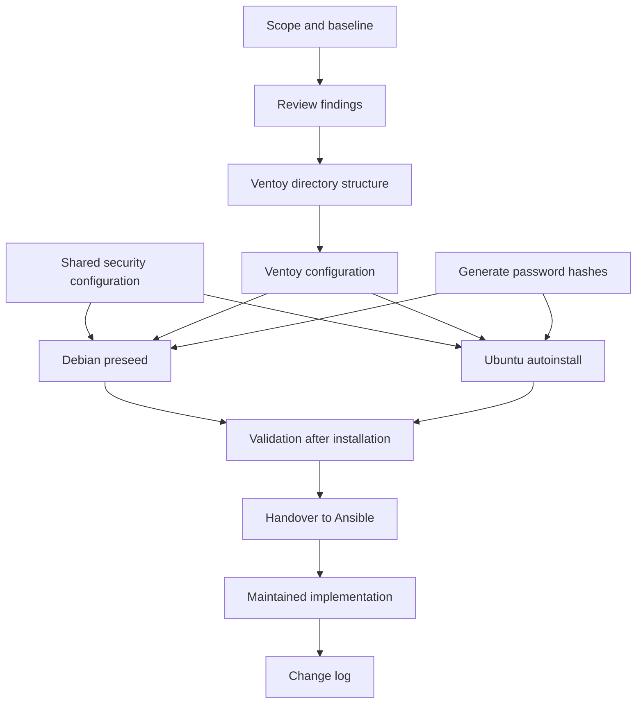

# Ventoy Automated Configuration for Debian and Ubuntu that produce the same baseline



Some renderers, including GitHub, disable clicks inside Mermaid charts. The same sections are linked here: [Scope and baseline](#scope-and-baseline), [Review findings](#review-findings), [Ventoy directory structure](#ventoy-directory-structure), [Ventoy configuration](#ventoy-configuration), [Shared security configuration](#shared-security-configuration), [Debian preseed](#debian-preseed), [Ubuntu autoinstall](#ubuntu-autoinstall), [Generate password hashes](#generate-password-hashes), [Validation after installation](#validation-after-installation), [Handover to Ansible](#handover-to-ansible), [Maintained implementation](#maintained-implementation), [Change log](#change-log), [References](#references).

## Scope and baseline

- Debian Stable, currently Debian 13 "trixie" <a id="cite-debian-example-preseed"></a>([Debian Project, n.d.-c](#ref-debian-example-preseed)): Debian Installer with preseed.
- Ubuntu Server LTS, currently Ubuntu 26.04 LTS <a id="cite-canonical-2026-release-notes"></a>([Canonical, 2026](#ref-canonical-2026-release-notes)): Subiquity with cloud-init autoinstall.
- Both: a root account with a local password, a user named `initial` with sudo, your SSH public key, SSH password authentication, and a bootstrap `nftables` firewall allowing new inbound connections on SSH only.
- Both: disk partitioning is left for manual confirmation until we have a reliable disk identifier.

The important distinction is that **the firewall allows SSH traffic; SSH then decides whether the connection authenticates with a key or a password.**

Everything these answer files write is the bootstrap state: enough to make a node reachable and safe. Ansible then takes over and owns the definitive state, including a Foomuuri firewall that replaces the bootstrap ruleset. See [Handover to Ansible](#handover-to-ansible).

Ubuntu Server 24.04 has a companion document, `ventoy-automated-configuration-for-ubuntu-24.04-server-v0.1.2.md`, that produces the same bootstrap node.

## Review findings

In version 0.1.1, version 0.1.0 was checked against the current Ventoy, Debian Installer, Subiquity and OpenSSH documentation. The overall design holds. The table lists what was confirmed and what had to change.

| Item | Status | Detail |
| --- | --- | --- |
| `ventoy.json` structure | Confirmed | `auto_install` with `image` and `template` is correct, and omitting `autosel` keeps the template prompt. |
| SSH drop-in content | Confirmed | The five directives produce the intended policy. |
| SSH base64 payload in the Debian `late_command` | Fixed | The 0.1.0 payload was corrupted partway through `KbdInteractiveAuthentication` and would have written a broken drop-in. Regenerated and round-trip checked. |
| nftables ruleset | Confirmed, one addition | Passes `nft -c`. A DHCPv6 client rule was added so hosts on DHCPv6 networks keep their addresses. |
| Debian base64 decoding | Changed | Decoding now runs inside the target system with `in-target`, so it relies on coreutils rather than on what the installer's BusyBox provides. |
| Debian `ssh.service` enable | Removed | Debian enables `ssh.service` when `openssh-server` is installed. Only `nftables.service` needs enabling. |
| Debian domain `local` | Changed | `.local` is reserved for Multicast DNS. Replaced with `home.arpa`. |
| Debian hostname | Changed | Added `netcfg/hostname` so DHCP cannot override the chosen name. |
| Debian file header, mirror and popularity-contest | Added | Added `#_preseed_V1`, mirror answers and a popularity-contest answer to avoid stray prompts. |
| Debian `debconf/priority` | Removed | Priority is normally set on the kernel command line; setting it inside the file has little effect. |
| Ubuntu top-level `hostname` | Removed | Not a valid autoinstall key. The hostname belongs in `identity`. |
| Ubuntu `identity.groups` | Removed | A plain list *replaces* the default groups, and `sudo` is already a default. Leaving it out also keeps older Subiquity releases happy. |
| Ubuntu root password through `user-data.users` | Changed | Replaced with `usermod --password` in `late-commands`, which runs during installation instead of on first boot. |
| Ubuntu `authorized_keys` written by hand | Removed | `ssh.authorized-keys` already installs the key. The manual commands duplicated it and assumed UID 1000. |
| Ubuntu SSH and nftables files | Added | The 0.1.0 `late-commands` never wrote them. |
| Ubuntu `ssh.service` enable | Removed | Ubuntu uses socket activation (`ssh.socket`). Enabling `ssh.service` as well works against that. |
| Ubuntu `sudo` package | Removed | Already part of Ubuntu Server. |

## Ventoy directory structure

On the Ventoy data partition:

```text
/
├── ISO/
│   ├── debian/
│   │   └── debian-stable-amd64.iso
│   └── ubuntu/
│       └── ubuntu-server-lts-amd64.iso
│
└── ventoy/
    ├── ventoy.json
    └── answer-files/
        ├── debian-preseed.cfg
        └── ubuntu-user-data
```

The ISO filenames above are placeholders. Use the actual filenames you download, or rename the files to match.

## Ventoy configuration

File: `/ventoy/ventoy.json`

```json
{
  "auto_install": [
    {
      "image": "/ISO/debian/debian-stable-amd64.iso",
      "template": "/ventoy/answer-files/debian-preseed.cfg"
    },
    {
      "image": "/ISO/ubuntu/ubuntu-server-lts-amd64.iso",
      "template": "/ventoy/answer-files/ubuntu-user-data"
    }
  ]
}
```

`auto_install` maps each ISO, or a whole parent directory, to one or more answer-file templates, and `autosel` can preselect one of them <a id="cite-ventoy-autoinstall"></a>([Ventoy, n.d.](#ref-ventoy-autoinstall)). `autosel` is deliberately omitted here. Ventoy then asks at boot whether to use the template, which protects against accidentally starting an unattended installation.

## Shared security configuration

Both installations write the same two bootstrap files. These are the single source of truth for the bootstrap baseline. Ansible replaces the firewall and may later change the SSH policy.

### SSH policy

File: `/etc/ssh/sshd_config.d/10-local-auth.conf`

```text
PermitRootLogin no
PubkeyAuthentication yes
PasswordAuthentication yes
KbdInteractiveAuthentication no
UsePAM yes
```

This gives us:

- A local root account with a password.
- No direct SSH login as root.
- SSH key authentication for `initial`.
- SSH password authentication for `initial`.

The `10-` prefix matters. For each keyword, `sshd` uses the first value it reads <a id="cite-openbsd-sshd-config"></a>([OpenBSD, n.d.](#ref-openbsd-sshd-config)), and both Debian and Ubuntu include `sshd_config.d/*.conf` at the top of the main file. Ubuntu's installer also writes `/etc/ssh/sshd_config.d/50-cloud-init.conf` with its own `PasswordAuthentication` line <a id="cite-launchpad-2088207"></a>([Launchpad, 2024](#ref-launchpad-2088207)). Because `10-local-auth.conf` sorts first, our settings win on both systems.

### Firewall

File: `/etc/nftables.conf`

```text
#!/usr/sbin/nft -f

flush ruleset

table inet filter {
    chain input {
        type filter hook input priority filter;
        policy drop;

        iifname "lo" accept
        ct state invalid drop
        ct state established,related accept

        ip protocol icmp accept
        meta l4proto ipv6-icmp accept

        ip6 saddr fe80::/10 udp sport 547 udp dport 546 accept

        tcp dport 22 ct state new accept
    }

    chain forward {
        type filter hook forward priority filter;
        policy drop;
    }

    chain output {
        type filter hook output priority filter;
        policy accept;
    }
}
```

This permits loopback, established connections, ICMP and ICMPv6, DHCPv6 replies to this host, and new SSH connections. Other unsolicited inbound traffic is dropped.

A DHCPv6 client sends its request to a multicast address and the server answers by unicast, so connection tracking does not treat the answer as part of an existing connection. Without the rule, a host that gets its IPv6 address from DHCPv6 would lose it. Hosts that use SLAAC only are already covered by the ICMPv6 rule.

`flush ruleset` clears every table, including tables that other tools such as Foomuuri, Incus or Docker create. That is acceptable for a bootstrap file that runs before anything else is installed, but it is why `nftables.service` must be disabled when Ansible hands the firewall to Foomuuri. See [Handover to Ansible](#handover-to-ansible).

## Debian preseed

File: `/ventoy/answer-files/debian-preseed.cfg`

A preconfiguration file should begin with `#_preseed_V1`, and its syntax can be checked before use with `debconf-set-selections -c` <a id="cite-debian-b3"></a>([Debian Project, n.d.-a](#ref-debian-b3)).

```text
#_preseed_V1

### Localization

d-i debian-installer/locale string en_CA.UTF-8
d-i keyboard-configuration/xkb-keymap select us

### Network

d-i netcfg/choose_interface select auto
d-i netcfg/get_hostname string debian-server
d-i netcfg/get_domain string home.arpa
d-i netcfg/hostname string debian-server

### Mirror

d-i mirror/country string manual
d-i mirror/http/hostname string deb.debian.org
d-i mirror/http/directory string /debian
d-i mirror/http/proxy string

### Clock and time zone

d-i clock-setup/utc boolean true
d-i time/zone string America/Toronto
d-i clock-setup/ntp boolean true

### Root account

d-i passwd/root-login boolean true
d-i passwd/root-password-crypted password ROOT_PASSWORD_HASH

### Initial user

d-i passwd/make-user boolean true
d-i passwd/user-fullname string Initial User
d-i passwd/username string initial
d-i passwd/user-password-crypted password INITIAL_PASSWORD_HASH

### Partitioning

# Deliberately not preseeded. The partitioner stops for manual confirmation.

### Package selection

tasksel tasksel/first multiselect standard, ssh-server
d-i pkgsel/include string sudo nftables
d-i pkgsel/upgrade select none
d-i pkgsel/update-policy select none
popularity-contest popularity-contest/participate boolean false

### Boot loader

d-i grub-installer/only_debian boolean true

### Post-install configuration

d-i preseed/late_command string \
    in-target usermod -aG sudo initial; \
    in-target install -d -m 0700 -o initial -g initial /home/initial/.ssh; \
    echo 'YOUR_SSH_PUBLIC_KEY' > /target/home/initial/.ssh/authorized_keys; \
    in-target chown initial:initial /home/initial/.ssh/authorized_keys; \
    in-target chmod 0600 /home/initial/.ssh/authorized_keys; \
    echo 'UGVybWl0Um9vdExvZ2luIG5vClB1YmtleUF1dGhlbnRpY2F0aW9uIHllcwpQYXNzd29yZEF1dGhlbnRpY2F0aW9uIHllcwpLYmRJbnRlcmFjdGl2ZUF1dGhlbnRpY2F0aW9uIG5vClVzZVBBTSB5ZXMK' > /target/tmp/10-local-auth.conf.b64; \
    in-target sh -c 'base64 -d /tmp/10-local-auth.conf.b64 > /etc/ssh/sshd_config.d/10-local-auth.conf && chmod 0644 /etc/ssh/sshd_config.d/10-local-auth.conf'; \
    echo 'IyEvdXNyL3NiaW4vbmZ0IC1mCgpmbHVzaCBydWxlc2V0Cgp0YWJsZSBpbmV0IGZpbHRlciB7CiAgICBjaGFpbiBpbnB1dCB7CiAgICAgICAgdHlwZSBmaWx0ZXIgaG9vayBpbnB1dCBwcmlvcml0eSBmaWx0ZXI7CiAgICAgICAgcG9saWN5IGRyb3A7CgogICAgICAgIGlpZm5hbWUgImxvIiBhY2NlcHQKICAgICAgICBjdCBzdGF0ZSBpbnZhbGlkIGRyb3AKICAgICAgICBjdCBzdGF0ZSBlc3RhYmxpc2hlZCxyZWxhdGVkIGFjY2VwdAoKICAgICAgICBpcCBwcm90b2NvbCBpY21wIGFjY2VwdAogICAgICAgIG1ldGEgbDRwcm90byBpcHY2LWljbXAgYWNjZXB0CgogICAgICAgIGlwNiBzYWRkciBmZTgwOjovMTAgdWRwIHNwb3J0IDU0NyB1ZHAgZHBvcnQgNTQ2IGFjY2VwdAoKICAgICAgICB0Y3AgZHBvcnQgMjIgY3Qgc3RhdGUgbmV3IGFjY2VwdAogICAgfQoKICAgIGNoYWluIGZvcndhcmQgewogICAgICAgIHR5cGUgZmlsdGVyIGhvb2sgZm9yd2FyZCBwcmlvcml0eSBmaWx0ZXI7CiAgICAgICAgcG9saWN5IGRyb3A7CiAgICB9CgogICAgY2hhaW4gb3V0cHV0IHsKICAgICAgICB0eXBlIGZpbHRlciBob29rIG91dHB1dCBwcmlvcml0eSBmaWx0ZXI7CiAgICAgICAgcG9saWN5IGFjY2VwdDsKICAgIH0KfQo=' > /target/tmp/nftables.conf.b64; \
    in-target sh -c 'base64 -d /tmp/nftables.conf.b64 > /etc/nftables.conf && chmod 0755 /etc/nftables.conf'; \
    rm -f /target/tmp/10-local-auth.conf.b64 /target/tmp/nftables.conf.b64; \
    in-target systemctl enable nftables.service

### Finish

d-i finish-install/reboot_in_progress note
```

### Notes on the Debian file

`late_command` runs just before the installation finishes, while the new system is still mounted at `/target`, and `in-target` runs a command inside that system <a id="cite-debian-b5"></a>([Debian Project, n.d.-b](#ref-debian-b5)). That is why the base64 payloads are written to `/target/tmp` and decoded with `in-target`.

The two base64 strings above are the exact contents of the shared files in [Shared security configuration](#shared-security-configuration). They were generated with `base64 -w0` and checked by decoding them and comparing the result byte for byte. Do not edit them by hand. Regenerate them from the shared files:

```sh
base64 -w0 shared/ssh/10-local-auth.conf
base64 -w0 shared/nftables/nftables.conf
```

Debian ships `nftables.service` disabled, so the rules in `/etc/nftables.conf` are not loaded at boot until the service is enabled <a id="cite-hertzog-mas-firewall"></a>([Hertzog & Mas, n.d.](#ref-hertzog-mas-firewall)). The last command handles that. `ssh.service` is already enabled by the `openssh-server` package.

`netcfg/get_hostname` is only a fallback when DHCP does not supply a name. `netcfg/hostname` forces the name regardless of DHCP, which is what we want for a consistent baseline (Debian Project, n.d.-c). The domain is `home.arpa` because `.local` is reserved for Multicast DNS <a id="cite-rfc6762"></a>([Cheshire & Krochmal, 2013](#ref-rfc6762)), and `home.arpa` is the name set aside for residential and small networks <a id="cite-rfc8375"></a>([Pfister & Lemon, 2018](#ref-rfc8375)). Leave the domain empty if the server should take one from DHCP.

Language and keyboard may still be asked before the preseed file is read, depending on how the installer receives it. Watch for this in the virtual machine test.

## Ubuntu autoinstall

File: `/ventoy/answer-files/ubuntu-user-data`

```yaml
#cloud-config
autoinstall:
  version: 1

  locale: en_CA.UTF-8

  keyboard:
    layout: us

  timezone: America/Toronto

  # Keep storage selection interactive.
  interactive-sections:
    - storage

  identity:
    hostname: ubuntu-server
    username: initial
    realname: Initial User
    password: "INITIAL_PASSWORD_HASH"

  ssh:
    install-server: true
    allow-pw: true
    authorized-keys:
      - "YOUR_SSH_PUBLIC_KEY"

  packages:
    - nftables

  late-commands:
    - mkdir -p /target/etc/ssh/sshd_config.d
    - |
      cat > /target/etc/ssh/sshd_config.d/10-local-auth.conf <<'EOF'
      PermitRootLogin no
      PubkeyAuthentication yes
      PasswordAuthentication yes
      KbdInteractiveAuthentication no
      UsePAM yes
      EOF
    - chmod 0644 /target/etc/ssh/sshd_config.d/10-local-auth.conf
    - |
      cat > /target/etc/nftables.conf <<'EOF'
      #!/usr/sbin/nft -f

      flush ruleset

      table inet filter {
          chain input {
              type filter hook input priority filter;
              policy drop;

              iifname "lo" accept
              ct state invalid drop
              ct state established,related accept

              ip protocol icmp accept
              meta l4proto ipv6-icmp accept

              ip6 saddr fe80::/10 udp sport 547 udp dport 546 accept

              tcp dport 22 ct state new accept
          }

          chain forward {
              type filter hook forward priority filter;
              policy drop;
          }

          chain output {
              type filter hook output priority filter;
              policy accept;
          }
      }
      EOF
    - chmod 0755 /target/etc/nftables.conf
    - [curtin, in-target, --target=/target, --, usermod, --password, "ROOT_PASSWORD_HASH", root]
    - [curtin, in-target, --target=/target, --, systemctl, enable, nftables.service]
```

### Notes on the Ubuntu file

A `late-commands` entry written as a string runs through `sh -c`, and an entry written as a list runs directly, in both cases with the new system mounted at `/target` <a id="cite-canonical-autoinstall-reference"></a>([Canonical, n.d.-a](#ref-canonical-autoinstall-reference)). The two file-writing entries use YAML block scalars, so the heredocs reach the shell with their indentation stripped and the files come out identical to the shared versions. The root password entry uses the list form so the `$` characters in the hash never pass through a shell.

The same reference explains the other changes from 0.1.0:

- Users in `identity` are created during installation, while users in `user-data` are created on first boot. Setting the root password in `late-commands` keeps it with the rest of the install and avoids mixing two user mechanisms.
- A plain list under `identity.groups` *replaces* the default groups, which already include `sudo`. Omitting `groups` keeps the defaults.
- `allow-pw` defaults to `false` when `authorized-keys` is present, so `allow-pw: true` must stay explicit.
- `authorized-keys` installs the key for the `initial` user, so no manual `authorized_keys` handling is needed.

The top-level `hostname` key from 0.1.0 is not part of the autoinstall schema. `hostname` only exists inside `identity`, which rejects any key it does not define <a id="cite-canonical-autoinstall-schema"></a>([Canonical, n.d.-b](#ref-canonical-autoinstall-schema)).

Since Ubuntu 22.10, OpenSSH starts through `ssh.socket` rather than a permanently running `ssh.service` <a id="cite-ubuntu-ssh-socket"></a>([Ubuntu Community Hub, n.d.](#ref-ubuntu-ssh-socket)). Enabling `ssh.service` as well is unnecessary and works against socket activation, so the file no longer does it. `ufw` is installed on Ubuntu Server but inactive. Leave it inactive so that only one tool manages the firewall.

## Generate password hashes

Install `whois`, which provides `mkpasswd`, on your workstation if necessary:

```sh
sudo apt install whois
```

Generate a SHA-512 password hash:

```sh
mkpasswd --method=sha-512
```

Generate separate hashes for:

- `initial`
- `root`

Replace `ROOT_PASSWORD_HASH` and `INITIAL_PASSWORD_HASH` in both answer files, and `YOUR_SSH_PUBLIC_KEY` with the contents of your `.pub` file. Keep the double quotes around the hashes in the Ubuntu YAML.

Do not put plaintext passwords in the Ventoy files. The hashes and public key are still sensitive installation material, so protect the USB drive.

## Validation after installation

These checks confirm the bootstrap state. Run them before the first Ansible run. Once installed, check the following on each server:

```sh
sudo -v
sudo id

sudo passwd -S root

sudo sshd -t

sudo sshd -T | grep -E \
  '^(permitrootlogin|passwordauthentication|pubkeyauthentication|kbdinteractiveauthentication) '

sudo nft list ruleset

systemctl is-enabled nftables
```

`passwd -S root` should report `P`, meaning root has a usable password. Check the SSH unit with the command for each system:

```sh
# Debian
systemctl status ssh

# Ubuntu, socket activated
systemctl status ssh.socket
```

On Ubuntu, `ssh.service` may show as inactive until the first connection arrives. That is expected.

Test both SSH authentication methods, and the root refusal, from another machine:

```sh
# Public key
ssh -o PreferredAuthentications=publickey initial@SERVER_IP

# Password
ssh -o PreferredAuthentications=password \
    -o PubkeyAuthentication=no initial@SERVER_IP

# Root must be refused
ssh -o PreferredAuthentications=password \
    -o PubkeyAuthentication=no root@SERVER_IP
```

Finally, reboot once and repeat `sudo nft list ruleset` to confirm the firewall loads at boot rather than only during installation.

## Handover to Ansible

### Division of responsibility

The installer stage makes a node reachable and safe. Ansible makes every node identical and keeps it that way. The rule that decides where a setting belongs: if Ansible would have to manage it anyway, it does not belong in an answer file.

| Stage | Responsible for |
| --- | --- |
| Ventoy | Carrying each ISO and its answer file to the installer. Ventoy creates no configuration itself. |
| Answer files | Installing the OS, the `root` and `initial` accounts, the SSH key, the bootstrap SSH policy and the bootstrap firewall. |
| Ansible | The definitive state: the Foomuuri firewall, the final SSH policy, packages, users and everything else that must match across nodes. |

The answer files always differ a little from one installer to the next, because Debian preseed and Ubuntu autoinstall are different mechanisms. The files they write are identical. Homogeneity across nodes comes from Ansible running the same roles everywhere and continuing to enforce them after the first day, which an installer cannot do.

### Bootstrap firewall

The bootstrap ruleset allows new inbound connections on port 22 only. It also accepts loopback traffic, replies to connections the node itself opened (package downloads, DNS), ICMP and ICMPv6, and DHCPv6 replies. None of these opens a new way in.

Keep the bootstrap firewall in the answer files even though Ansible replaces it. Each node starts with SSH password authentication enabled, so it needs filtering from first boot until the first Ansible run.

### Replacing the bootstrap firewall with Foomuuri

The bootstrap `/etc/nftables.conf` starts with `flush ruleset`, which clears every table, chain, rule and set in the kernel <a id="cite-canonical-nftables"></a>([Canonical, n.d.-c](#ref-canonical-nftables)). That includes Foomuuri's rules, so `nftables.service` must not stay enabled once Foomuuri takes over. The Ansible play should follow this order:

1. Install `foomuuri`, deploy the configuration templates and run `foomuuri check` before anything is applied.
2. Enable and start Foomuuri, then confirm that a new SSH connection still succeeds.
3. Remove the bootstrap table with `nft delete table inet filter` and disable the old loader with `systemctl disable nftables`. Optionally replace `/etc/nftables.conf` with a stub that contains no `flush ruleset`, so a stray restart cannot remove Foomuuri's rules.
4. Reboot once and confirm with `nft list tables` that only Foomuuri's table remains.

Steps 2 and 3 are ordered so that both tables exist briefly. A packet must then be accepted by both, which makes the overlap stricter rather than looser. Access is lost only if the Foomuuri configuration itself drops SSH. For the first rollout, schedule a timed rollback before the cutover, for example with `systemd-run --on-active=5m` re-enabling the bootstrap rules, and cancel it once Ansible reconnects. Alternatively, run the first cutover on an Incus virtual machine with console access.

### Foomuuri versions

The packaged Foomuuri version differs by release:

| Release | Package |
| --- | --- |
| Ubuntu 24.04 | 0.22, universe component <a id="cite-ubuntu-packages-foomuuri"></a>([Ubuntu, n.d.](#ref-ubuntu-packages-foomuuri)) |
| Debian 13 | 0.27, with 0.31 in trixie-backports <a id="cite-debian-sources-foomuuri"></a>([Debian Project, n.d.-d](#ref-debian-sources-foomuuri)) |
| Ubuntu 26.04 | Check the archive before writing the role |

One Ansible template may not behave the same on 0.22 and 0.31. Either pin one version on every node (backports on Debian, an upstream or locally built package on Ubuntu), or write the configuration against the oldest version deployed and test it on each release. On Ubuntu, the universe component receives community rather than Canonical security maintenance, so confirm that security fixes have reached the version in use.

On servers, do not install `foomuuri-firewalld` or enable the D-Bus service. Zone switching driven by NetworkManager is only useful on desktops.

### Optional tighter bootstrap

A stricter variant would install with key-only SSH (`PasswordAuthentication no` in the drop-in, and `allow-pw: false` on Ubuntu), and let Ansible enable password authentication once Foomuuri is in place. This removes password logins from the window between first boot and the first Ansible run. It is not adopted in this version, because the baseline as specified includes password authentication from the start.

## Maintained implementation

Avoid maintaining two copies of the SSH and firewall configuration. Keep the shared files in a small repository and generate the installer-specific answer files from them.

```text
server-install/
├── README.md
├── shared/
│   ├── ssh/
│   │   └── 10-local-auth.conf
│   └── nftables/
│       └── nftables.conf
├── debian/
│   └── preseed.cfg.in
├── ubuntu/
│   └── user-data.in
├── ventoy/
│   └── ventoy.json
└── bin/
    └── build-install-media.py
```

The Python build script would:

1. Read the shared SSH and nftables configuration.
2. Insert them into the Debian template as base64 payloads and into the Ubuntu template as heredocs.
3. Insert the public key and password hashes from protected local inputs.
4. Generate the final files for the Ventoy USB.
5. Validate the output: `debconf-set-selections -c` for the preseed file, YAML parsing for `user-data`, JSON parsing for `ventoy.json`, `nft -c -f` for the ruleset, and `sshd -t` for the SSH drop-in.
6. Never write private keys or plaintext passwords into the output.

This also removes the maintenance problem of hand-editing long embedded shell commands.

The Ansible roles that take over from the bootstrap state, including the Foomuuri role, belong in their own repository. The answer files only need to guarantee what Ansible relies on to connect: the `initial` account with sudo, the SSH key and port 22 reachable.

### Qualification

These are reviewed configuration templates, not yet a tested turnkey installer. Validate both in Incus virtual machines before using them on physical hardware, especially account creation, the root password, the SSH configuration and firewall activation at boot. Disk partitioning should remain a deliberate decision until we specify how to identify the target device.

## Change log

### 0.1.2, 2026-11-14

- Defined the answer files as the bootstrap stage and Ansible as the owner of the definitive state.
- Added [Handover to Ansible](#handover-to-ansible): division of responsibility, the bootstrap firewall, the ordered cutover to Foomuuri, Foomuuri package versions by release, and an optional key-only bootstrap.
- Reworded the `flush ruleset` note to explain why `nftables.service` is disabled at handover.
- Added the 26.04 label to the filename and a pointer to the Ubuntu 24.04 companion, `ventoy-automated-configuration-for-ubuntu-24.04-server-v0.1.2.md`.
- Moved the qualification note into its own subsection, following the house style.
- No changes to the answer files or the shared bootstrap files.

### 0.1.1, 2026-11-14

- Reviewed the configuration against current Ventoy, Debian Installer, Subiquity and OpenSSH documentation; findings are in [Review findings](#review-findings).
- Fixed the corrupted SSH base64 payload in the Debian `late_command`.
- Added a DHCPv6 client rule to the shared nftables ruleset.
- Debian: added `#_preseed_V1`, forced hostname, `home.arpa` domain, mirror and popularity-contest answers; moved base64 decoding into the target; removed `debconf/priority` and the redundant `ssh.service` enable.
- Ubuntu: removed the invalid top-level `hostname`, `identity.groups`, the `user-data.users` block, the manual `authorized_keys` commands and the `ssh.service` enable; added the SSH and nftables files and the root password to `late-commands`.
- Validation: added checks for the root password, `ssh.socket` on Ubuntu, root refusal over SSH and firewall persistence across a reboot.
- Added a navigation chart, APA 7 citations and references.

### 0.1.0

- Initial draft.

## References

<a id="ref-canonical-autoinstall-reference"></a>
Canonical. (n.d.-a). *Autoinstall configuration reference manual*. Subiquity documentation. Retrieved November 14, 2026, from https://canonical-subiquity.readthedocs-hosted.com/en/latest/reference/autoinstall-reference.html
[Return to citation](#cite-canonical-autoinstall-reference)

<a id="ref-canonical-autoinstall-schema"></a>
Canonical. (n.d.-b). *Autoinstall schema*. Subiquity documentation. Retrieved November 14, 2026, from https://canonical-subiquity.readthedocs-hosted.com/en/latest/reference/autoinstall-schema.html
[Return to citation](#cite-canonical-autoinstall-schema)

<a id="ref-canonical-nftables"></a>
Canonical. (n.d.-c). *nftables*. Ubuntu security documentation. Retrieved November 14, 2026, from https://documentation.ubuntu.com/security/security-features/network/firewall/nftables/
[Return to citation](#cite-canonical-nftables)

<a id="ref-canonical-2026-release-notes"></a>
Canonical. (2026, April 23). *Ubuntu 26.04 LTS release notes*. https://documentation.ubuntu.com/release-notes/26.04/
[Return to citation](#cite-canonical-2026-release-notes)

<a id="ref-rfc6762"></a>
Cheshire, S., & Krochmal, M. (2013). *Multicast DNS* (RFC 6762). RFC Editor. https://doi.org/10.17487/RFC6762
[Return to citation](#cite-rfc6762)

<a id="ref-debian-b3"></a>
Debian Project. (n.d.-a). B.3. Creating a preconfiguration file. In *Debian GNU/Linux installation guide: trixie, amd64*. Retrieved November 14, 2026, from https://www.debian.org/releases/trixie/amd64/apbs03.en.html
[Return to citation](#cite-debian-b3)

<a id="ref-debian-b5"></a>
Debian Project. (n.d.-b). B.5. Advanced options. In *Debian GNU/Linux installation guide: trixie, amd64*. Retrieved November 14, 2026, from https://www.debian.org/releases/trixie/amd64/apbs05.en.html
[Return to citation](#cite-debian-b5)

<a id="ref-debian-example-preseed"></a>
Debian Project. (n.d.-c). *Example preconfiguration file (for trixie)*. Retrieved November 14, 2026, from https://www.debian.org/releases/stable/example-preseed.txt
[Return to citation](#cite-debian-example-preseed)

<a id="ref-debian-sources-foomuuri"></a>
Debian Project. (n.d.-d). *Package: foomuuri*. Debian sources. Retrieved November 14, 2026, from https://sources.debian.org/patches/foomuuri
[Return to citation](#cite-debian-sources-foomuuri)

<a id="ref-hertzog-mas-firewall"></a>
Hertzog, R., & Mas, R. (n.d.). Firewall or packet filtering. In *The Debian administrator's handbook*. Retrieved November 14, 2026, from https://www.debian.org/doc/manuals/debian-handbook/sect.firewall-packet-filtering.en.html
[Return to citation](#cite-hertzog-mas-firewall)

<a id="ref-launchpad-2088207"></a>
Launchpad. (2024). *Bug #2088207: cloud-init enables ssh password auth in an unexpected config file*. https://bugs.launchpad.net/bugs/2088207
[Return to citation](#cite-launchpad-2088207)

<a id="ref-openbsd-sshd-config"></a>
OpenBSD. (n.d.). *sshd_config(5): OpenSSH daemon configuration file*. OpenBSD manual pages. Retrieved November 14, 2026, from https://man.openbsd.org/sshd_config
[Return to citation](#cite-openbsd-sshd-config)

<a id="ref-rfc8375"></a>
Pfister, P., & Lemon, T. (2018). *Special-use domain 'home.arpa.'* (RFC 8375). RFC Editor. https://doi.org/10.17487/RFC8375
[Return to citation](#cite-rfc8375)

<a id="ref-ubuntu-packages-foomuuri"></a>
Ubuntu. (n.d.). *Package: foomuuri (0.22-1) [universe], noble (24.04LTS)*. Ubuntu packages. Retrieved November 14, 2026, from https://packages.ubuntu.com/noble/foomuuri
[Return to citation](#cite-ubuntu-packages-foomuuri)

<a id="ref-ubuntu-ssh-socket"></a>
Ubuntu Community Hub. (n.d.). *sshd now uses socket-based activation (Ubuntu 22.10 and later)*. Retrieved November 14, 2026, from https://discourse.ubuntu.com/t/sshd-now-uses-socket-based-activation-ubuntu-22-10-and-later/30189
[Return to citation](#cite-ubuntu-ssh-socket)

<a id="ref-ventoy-autoinstall"></a>
Ventoy. (n.d.). *Auto installation plugin*. Retrieved November 14, 2026, from https://www.ventoy.net/en/plugin_autoinstall.html
[Return to citation](#cite-ventoy-autoinstall)
