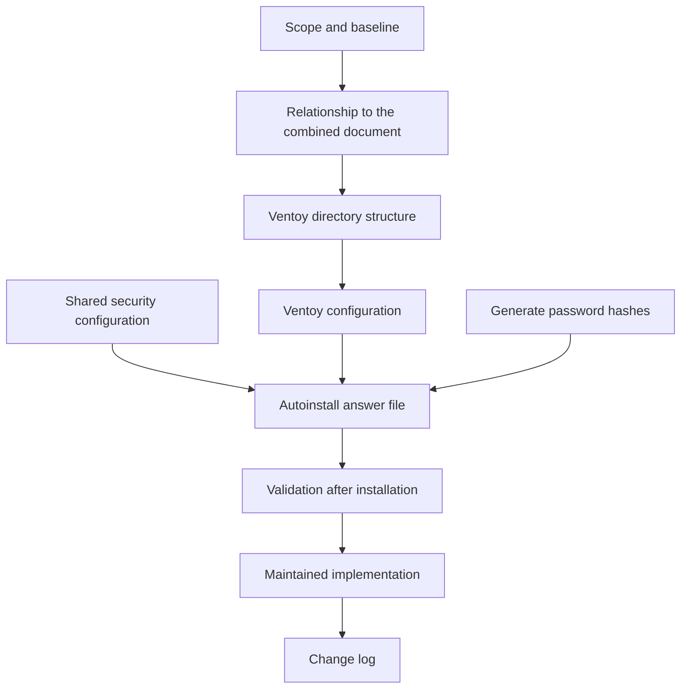

# Ventoy Automated Configuration for Ubuntu 24.04 Server



Some renderers, including GitHub, disable clicks inside Mermaid charts. The same sections are linked here: [Scope and baseline](#scope-and-baseline), [Relationship to the combined document](#relationship-to-the-combined-document), [Ventoy directory structure](#ventoy-directory-structure), [Ventoy configuration](#ventoy-configuration), [Shared security configuration](#shared-security-configuration), [Autoinstall answer file](#autoinstall-answer-file), [Generate password hashes](#generate-password-hashes), [Validation after installation](#validation-after-installation), [Maintained implementation](#maintained-implementation), [Change log](#change-log), [References](#references).

## Scope and baseline

- Ubuntu Server 24.04 LTS "Noble Numbat", installed with Subiquity and cloud-init autoinstall. The current installation media is the 24.04.4 point release, and Ubuntu Server 24.04 receives maintenance updates for five years from its April 2024 release <a id="cite-jacquet-2026"></a>([Jacquet, 2026](#ref-jacquet-2026)).
- A root account with a local password, a user named `initial` with sudo, your SSH public key, SSH password authentication, and an `nftables` firewall allowing inbound SSH only.
- Disk partitioning is left for manual confirmation until we have a reliable disk identifier.

The important distinction is that **the firewall allows SSH traffic; SSH then decides whether the connection authenticates with a key or a password.**

## Relationship to the combined document

This document is the Ubuntu 24.04 companion to `ventoy-automated-configuration-for-debian-and-ubuntu-v0.1.1.md`, which covers Debian Stable and the current Ubuntu Server LTS (26.04). The resulting node is the same:

| Setting | Value |
| --- | --- |
| Hostname | `ubuntu-server` |
| Locale, keyboard, time zone | `en_CA.UTF-8`, `us`, `America/Toronto` |
| Accounts | `root` with a local password, `initial` in `sudo` |
| SSH drop-in | `/etc/ssh/sshd_config.d/10-local-auth.conf`, identical byte for byte |
| Firewall | `/etc/nftables.conf`, identical byte for byte, loaded at boot by `nftables.service` |
| Storage | Interactive |

The answer file is the same as the 26.04 one except for one detail. The root password command in `late-commands` is written as a single-quoted string rather than a list, so it does not depend on newer Subiquity behaviour. Both forms set the same password.

## Ventoy directory structure

On the Ventoy data partition:

```text
/
├── ISO/
│   └── ubuntu/
│       └── ubuntu-24.04.4-live-server-amd64.iso
│
└── ventoy/
    ├── ventoy.json
    └── answer-files/
        └── ubuntu-24.04-user-data
```

Use the filename of the ISO you actually download, or rename the file to match. If this USB drive also carries the Debian and Ubuntu 26.04 images, add this entry to the existing `ventoy.json` rather than replacing it.

## Ventoy configuration

File: `/ventoy/ventoy.json`

```json
{
  "auto_install": [
    {
      "image": "/ISO/ubuntu/ubuntu-24.04.4-live-server-amd64.iso",
      "template": "/ventoy/answer-files/ubuntu-24.04-user-data"
    }
  ]
}
```

`auto_install` maps an ISO, or a whole parent directory, to one or more answer-file templates, and `autosel` can preselect one of them <a id="cite-ventoy-autoinstall"></a>([Ventoy, n.d.](#ref-ventoy-autoinstall)). `autosel` is deliberately omitted. Ventoy then asks at boot whether to use the template, which protects against accidentally starting an unattended installation.

## Shared security configuration

These two files are the single source of truth for the baseline. They are identical to the files in the combined document.

### SSH policy

File: `/etc/ssh/sshd_config.d/10-local-auth.conf`

```text
PermitRootLogin no
PubkeyAuthentication yes
PasswordAuthentication yes
KbdInteractiveAuthentication no
UsePAM yes
```

This gives us:

- A local root account with a password.
- No direct SSH login as root.
- SSH key authentication for `initial`.
- SSH password authentication for `initial`.

The `10-` prefix matters. For each keyword, `sshd` uses the first value it reads <a id="cite-openbsd-sshd-config"></a>([OpenBSD, n.d.](#ref-openbsd-sshd-config)), and Ubuntu includes `sshd_config.d/*.conf` at the top of the main file. The 24.04 installer also writes `/etc/ssh/sshd_config.d/50-cloud-init.conf` with its own `PasswordAuthentication` line <a id="cite-launchpad-2088207"></a>([Launchpad, 2024](#ref-launchpad-2088207)). Because `10-local-auth.conf` sorts first, our settings win.

### Firewall

File: `/etc/nftables.conf`

```text
#!/usr/sbin/nft -f

flush ruleset

table inet filter {
    chain input {
        type filter hook input priority filter;
        policy drop;

        iifname "lo" accept
        ct state invalid drop
        ct state established,related accept

        ip protocol icmp accept
        meta l4proto ipv6-icmp accept

        ip6 saddr fe80::/10 udp sport 547 udp dport 546 accept

        tcp dport 22 ct state new accept
    }

    chain forward {
        type filter hook forward priority filter;
        policy drop;
    }

    chain output {
        type filter hook output priority filter;
        policy accept;
    }
}
```

This permits loopback, established connections, ICMP and ICMPv6, DHCPv6 replies to this host, and new SSH connections. Other unsolicited inbound traffic is dropped.

A DHCPv6 client sends its request to a multicast address and the server answers by unicast, so connection tracking does not treat the answer as part of an existing connection. The DHCPv6 rule keeps hosts on DHCPv6 networks from losing their IPv6 address. Hosts that use SLAAC only are already covered by the ICMPv6 rule.

`flush ruleset` clears every table, including tables that other tools such as Incus or Docker create. That is fine for this baseline. If such a tool is added later, restarting `nftables.service` would remove its rules, so scope the flush to this table at that point.

## Autoinstall answer file

File: `/ventoy/answer-files/ubuntu-24.04-user-data`

```yaml
#cloud-config
autoinstall:
  version: 1

  locale: en_CA.UTF-8

  keyboard:
    layout: us

  timezone: America/Toronto

  # Keep storage selection interactive.
  interactive-sections:
    - storage

  identity:
    hostname: ubuntu-server
    username: initial
    realname: Initial User
    password: "INITIAL_PASSWORD_HASH"

  ssh:
    install-server: true
    allow-pw: true
    authorized-keys:
      - "YOUR_SSH_PUBLIC_KEY"

  packages:
    - nftables

  late-commands:
    - mkdir -p /target/etc/ssh/sshd_config.d
    - |
      cat > /target/etc/ssh/sshd_config.d/10-local-auth.conf <<'EOF'
      PermitRootLogin no
      PubkeyAuthentication yes
      PasswordAuthentication yes
      KbdInteractiveAuthentication no
      UsePAM yes
      EOF
    - chmod 0644 /target/etc/ssh/sshd_config.d/10-local-auth.conf
    - |
      cat > /target/etc/nftables.conf <<'EOF'
      #!/usr/sbin/nft -f

      flush ruleset

      table inet filter {
          chain input {
              type filter hook input priority filter;
              policy drop;

              iifname "lo" accept
              ct state invalid drop
              ct state established,related accept

              ip protocol icmp accept
              meta l4proto ipv6-icmp accept

              ip6 saddr fe80::/10 udp sport 547 udp dport 546 accept

              tcp dport 22 ct state new accept
          }

          chain forward {
              type filter hook forward priority filter;
              policy drop;
          }

          chain output {
              type filter hook output priority filter;
              policy accept;
          }
      }
      EOF
    - chmod 0755 /target/etc/nftables.conf
    - curtin in-target --target=/target -- usermod --password 'ROOT_PASSWORD_HASH' root
    - curtin in-target --target=/target -- systemctl enable nftables.service
```

### Notes on the Ubuntu 24.04 file

A `late-commands` entry written as a string runs through `sh -c`, with the new system mounted at `/target` <a id="cite-canonical-autoinstall-reference"></a>([Canonical, n.d.-a](#ref-canonical-autoinstall-reference)). The two file-writing entries use YAML block scalars, so the heredocs reach the shell with their indentation stripped and the files come out identical to the shared versions. The root password hash is wrapped in single quotes so the shell does not expand its `$` characters. A crypt hash never contains a single quote, so this is safe.

The same reference explains the rest of the file:

- Users in `identity` are created during installation, while users in `user-data` are created on first boot. Setting the root password in `late-commands` keeps it with the rest of the install.
- `identity` is not given a `groups` key. The default groups already include `sudo`, and a plain list would replace them. Leaving it out also avoids depending on newer Subiquity releases.
- `allow-pw` defaults to `false` when `authorized-keys` is present, so `allow-pw: true` must stay explicit.
- `authorized-keys` installs the key for the `initial` user, so no manual `authorized_keys` handling is needed.

`hostname` exists only inside `identity`, and `identity` rejects any key it does not define <a id="cite-canonical-autoinstall-schema"></a>([Canonical, n.d.-b](#ref-canonical-autoinstall-schema)). Do not add a top-level `hostname`.

Since Ubuntu 22.10, OpenSSH starts through `ssh.socket` rather than a permanently running `ssh.service`, and 24.04 follows that default <a id="cite-ubuntu-ssh-socket"></a>([Ubuntu Community Hub, n.d.](#ref-ubuntu-ssh-socket)). The file therefore does not enable `ssh.service`. `ufw` is installed on Ubuntu Server but inactive. Leave it inactive so that only one tool manages the firewall.

The Subiquity documentation cited here is the current version. Subiquity can refresh itself at the start of an installation when the machine has network access, so the version that actually runs may be newer than the one on the 24.04.4 ISO. Every key used above has been part of autoinstall since well before 24.04.

## Generate password hashes

Install `whois`, which provides `mkpasswd`, on your workstation if necessary:

```sh
sudo apt install whois
```

Generate a SHA-512 password hash:

```sh
mkpasswd --method=sha-512
```

Generate separate hashes for:

- `initial`
- `root`

Replace `ROOT_PASSWORD_HASH` and `INITIAL_PASSWORD_HASH`, and `YOUR_SSH_PUBLIC_KEY` with the contents of your `.pub` file. Keep the double quotes around the `identity` hash and the single quotes around the root hash.

Do not put plaintext passwords in the Ventoy files. The hashes and public key are still sensitive installation material, so protect the USB drive.

## Validation after installation

Once installed, check the following:

```sh
lsb_release -d

sudo -v
sudo id

sudo passwd -S root

sudo sshd -t

sudo sshd -T | grep -E \
  '^(permitrootlogin|passwordauthentication|pubkeyauthentication|kbdinteractiveauthentication) '

sudo nft list ruleset

systemctl is-enabled nftables
systemctl status ssh.socket
```

`lsb_release -d` should report Ubuntu 24.04. `passwd -S root` should report `P`, meaning root has a usable password. `ssh.service` may show as inactive until the first connection arrives. That is expected with socket activation.

Test both SSH authentication methods, and the root refusal, from another machine:

```sh
# Public key
ssh -o PreferredAuthentications=publickey initial@SERVER_IP

# Password
ssh -o PreferredAuthentications=password \
    -o PubkeyAuthentication=no initial@SERVER_IP

# Root must be refused
ssh -o PreferredAuthentications=password \
    -o PubkeyAuthentication=no root@SERVER_IP
```

Finally, reboot once and repeat `sudo nft list ruleset` to confirm the firewall loads at boot rather than only during installation.

To confirm the node matches one built from the combined document, compare checksums of the two shared files on both machines:

```sh
sha256sum /etc/ssh/sshd_config.d/10-local-auth.conf /etc/nftables.conf
```

## Maintained implementation

The shared files and the generator from the combined document cover this release too. Add one template for 24.04:

```text
server-install/
├── README.md
├── shared/
│   ├── ssh/
│   │   └── 10-local-auth.conf
│   └── nftables/
│       └── nftables.conf
├── debian/
│   └── preseed.cfg.in
├── ubuntu/
│   ├── user-data.in
│   └── user-data-24.04.in
├── ventoy/
│   └── ventoy.json
└── bin/
    └── build-install-media.py
```

The build script inserts the shared files and the protected inputs (public key and password hashes) into each template, writes the Ventoy files, and validates the output: YAML parsing for each `user-data`, JSON parsing for `ventoy.json`, `nft -c -f` for the ruleset, and `sshd -t` for the SSH drop-in. It never writes private keys or plaintext passwords.

**Qualification:** this is a reviewed configuration template, not yet a tested turnkey installer. Validate it in an Incus virtual machine with the 24.04.4 ISO before using it on physical hardware, especially account creation, the root password, the SSH configuration and firewall activation at boot. Disk partitioning should remain a deliberate decision until we specify how to identify the target device.

## Change log

### 0.1.1, 2026-11-14

- First release, numbered in step with `ventoy-automated-configuration-for-debian-and-ubuntu-v0.1.1.md`.
- Derived from the Ubuntu section of that document, with the same accounts, SSH policy and nftables ruleset.
- The root password command uses a single-quoted string instead of the list form.
- Added a section on the relationship to the combined document and a checksum comparison step in validation.

## References

<a id="ref-canonical-autoinstall-reference"></a>
Canonical. (n.d.-a). *Autoinstall configuration reference manual*. Subiquity documentation. Retrieved November 14, 2026, from https://canonical-subiquity.readthedocs-hosted.com/en/latest/reference/autoinstall-reference.html
[Return to citation](#cite-canonical-autoinstall-reference)

<a id="ref-canonical-autoinstall-schema"></a>
Canonical. (n.d.-b). *Autoinstall schema*. Subiquity documentation. Retrieved November 14, 2026, from https://canonical-subiquity.readthedocs-hosted.com/en/latest/reference/autoinstall-schema.html
[Return to citation](#cite-canonical-autoinstall-schema)

<a id="ref-jacquet-2026"></a>
Jacquet, F. (2026, February 12). *Ubuntu 24.04.4 LTS released* [Mailing list post]. ubuntu-announce. https://lists.ubuntu.com/archives/ubuntu-announce/2026-February/000321.html
[Return to citation](#cite-jacquet-2026)

<a id="ref-launchpad-2088207"></a>
Launchpad. (2024). *Bug #2088207: cloud-init enables ssh password auth in an unexpected config file*. https://bugs.launchpad.net/bugs/2088207
[Return to citation](#cite-launchpad-2088207)

<a id="ref-openbsd-sshd-config"></a>
OpenBSD. (n.d.). *sshd_config(5): OpenSSH daemon configuration file*. OpenBSD manual pages. Retrieved November 14, 2026, from https://man.openbsd.org/sshd_config
[Return to citation](#cite-openbsd-sshd-config)

<a id="ref-ubuntu-ssh-socket"></a>
Ubuntu Community Hub. (n.d.). *sshd now uses socket-based activation (Ubuntu 22.10 and later)*. Retrieved November 14, 2026, from https://discourse.ubuntu.com/t/sshd-now-uses-socket-based-activation-ubuntu-22-10-and-later/30189
[Return to citation](#cite-ubuntu-ssh-socket)

<a id="ref-ventoy-autoinstall"></a>
Ventoy. (n.d.). *Auto installation plugin*. Retrieved November 14, 2026, from https://www.ventoy.net/en/plugin_autoinstall.html
[Return to citation](#cite-ventoy-autoinstall)
