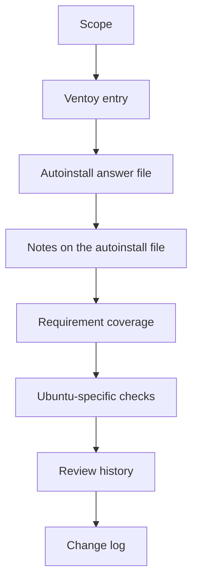

# Ventoy Automated Configuration for Ubuntu 26.04 Server



Some renderers, including GitHub, disable clicks inside Mermaid charts. The same sections are linked here: [Scope](#scope), [Ventoy entry](#ventoy-entry), [Autoinstall answer file](#autoinstall-answer-file), [Notes on the autoinstall file](#notes-on-the-autoinstall-file), [Requirement coverage](#requirement-coverage), [Ubuntu-specific checks](#ubuntu-specific-checks), [Review history](#review-history), [Change log](#change-log), [References](#references).

## Scope

- Ubuntu Server 26.04 LTS <a id="cite-canonical-2026-release-notes"></a>([Canonical, 2026](#ref-canonical-2026-release-notes)), installed with Subiquity and cloud-init autoinstall.
- The result is the raw node defined in `ventoy-raw-node-baseline-v0.2.0.md`. That document holds the requirements (RN-01 to RN-11), the canonical SSH and firewall files, password hash generation, the general acceptance checks and the handover to Ansible. This document holds only what is specific to Ubuntu 26.04.
- The default hostname is `ubuntu-server`.

## Ventoy entry

Place the ISO and answer file as shown in the baseline document's directory structure:

```text
/ISO/ubuntu/ubuntu-26.04.N-live-server-amd64.iso
/ventoy/answer-files/ubuntu-26.04-user-data
```

The matching `ventoy.json` entry:

```json
{
  "image": "/ISO/ubuntu/ubuntu-26.04.N-live-server-amd64.iso",
  "template": "/ventoy/answer-files/ubuntu-26.04-user-data"
}
```

Replace `N` with the point release you download.

## Autoinstall answer file

File: `/ventoy/answer-files/ubuntu-26.04-user-data`

```yaml
#cloud-config
autoinstall:
  version: 1

  locale: en_CA.UTF-8

  keyboard:
    layout: us

  timezone: America/Toronto

  # Keep storage selection interactive.
  interactive-sections:
    - storage

  identity:
    hostname: ubuntu-server
    username: initial
    realname: Initial User
    password: "INITIAL_PASSWORD_HASH"

  ssh:
    install-server: true
    allow-pw: true
    authorized-keys:
      - "YOUR_SSH_PUBLIC_KEY"

  packages:
    - nftables
    - python3

  late-commands:
    - mkdir -p /target/etc/ssh/sshd_config.d
    - |
      cat > /target/etc/ssh/sshd_config.d/10-local-auth.conf <<'EOF'
      PermitRootLogin no
      PubkeyAuthentication yes
      PasswordAuthentication yes
      KbdInteractiveAuthentication no
      UsePAM yes
      EOF
    - chmod 0644 /target/etc/ssh/sshd_config.d/10-local-auth.conf
    - |
      cat > /target/etc/nftables.conf <<'EOF'
      #!/usr/sbin/nft -f

      flush ruleset

      table inet filter {
          chain input {
              type filter hook input priority filter;
              policy drop;

              iifname "lo" accept
              ct state invalid drop
              ct state established,related accept

              ip protocol icmp accept
              meta l4proto ipv6-icmp accept

              ip6 saddr fe80::/10 udp sport 547 udp dport 546 accept

              tcp dport 22 ct state new accept
          }

          chain forward {
              type filter hook forward priority filter;
              policy drop;
          }

          chain output {
              type filter hook output priority filter;
              policy accept;
          }
      }
      EOF
    - chmod 0755 /target/etc/nftables.conf
    - [curtin, in-target, --target=/target, --, usermod, --password, "ROOT_PASSWORD_HASH", root]
    - [curtin, in-target, --target=/target, --, systemctl, enable, nftables.service]
```

Replace `ROOT_PASSWORD_HASH`, `INITIAL_PASSWORD_HASH` and `YOUR_SSH_PUBLIC_KEY` as described in the baseline document. Keep the double quotes around all three in this file.

## Notes on the autoinstall file

A `late-commands` entry written as a string runs through `sh -c`, and an entry written as a list runs directly, in both cases with the new system mounted at `/target` <a id="cite-canonical-autoinstall-reference"></a>([Canonical, n.d.-a](#ref-canonical-autoinstall-reference)). The two file-writing entries use YAML block scalars, so the heredocs reach the shell with their indentation stripped and the files come out identical to the canonical versions. The root password entry uses the list form so the `$` characters in the hash never pass through a shell.

The same reference explains the rest of the file:

- Users in `identity` are created during installation, while users in `user-data` are created on first boot. Setting the root password in `late-commands` keeps it with the rest of the install.
- A plain list under `identity.groups` replaces the default groups, which already include `sudo`. Omitting `groups` keeps the defaults.
- `allow-pw` defaults to `false` when `authorized-keys` is present, so `allow-pw: true` must stay explicit.
- `authorized-keys` installs the key for the `initial` user, so no manual `authorized_keys` handling is needed.

`hostname` exists only inside `identity`, and `identity` rejects any key it does not define <a id="cite-canonical-autoinstall-schema"></a>([Canonical, n.d.-b](#ref-canonical-autoinstall-schema)). Do not add a top-level `hostname`.

The installer writes `/etc/ssh/sshd_config.d/50-cloud-init.conf` with its own `PasswordAuthentication` line <a id="cite-launchpad-2088207"></a>([Launchpad, 2024](#ref-launchpad-2088207)). Because Ubuntu includes `sshd_config.d/*.conf` at the top of `sshd_config` and `10-local-auth.conf` sorts first, the canonical drop-in wins, as RN-07 requires.

Since Ubuntu 22.10, OpenSSH starts through `ssh.socket` rather than a permanently running `ssh.service` <a id="cite-ubuntu-ssh-socket"></a>([Ubuntu Community Hub, n.d.](#ref-ubuntu-ssh-socket)). The file therefore does not enable `ssh.service`. `ufw` is installed on Ubuntu Server but inactive. Leave it inactive so that `nftables` is the only firewall manager, as RN-08 requires.

`python3` is part of Ubuntu Server already. It is listed in `packages` so that RN-09 is explicit in the answer file.

## Requirement coverage

| ID | How this answer file meets it |
| --- | --- |
| RN-01 | `identity.hostname` set to `ubuntu-server` |
| RN-02 | `locale`, `keyboard`, `timezone`; network time is enabled by default in Ubuntu Server |
| RN-03 | `usermod --password` in `late-commands`; root SSH login refused by the drop-in |
| RN-04 | `identity.username` and `identity.password`; default groups include `sudo` |
| RN-05 | `ssh.authorized-keys` |
| RN-06 | `ssh.install-server`; listening through `ssh.socket` |
| RN-07 | Heredoc writes `/etc/ssh/sshd_config.d/10-local-auth.conf`, which sorts before `50-cloud-init.conf` |
| RN-08 | `nftables` in `packages`; heredoc writes `/etc/nftables.conf`; `systemctl enable nftables.service`; `ufw` stays inactive |
| RN-09 | `python3` in `packages` |
| RN-10 | `interactive-sections: [storage]` |
| RN-11 | Only crypt hashes and the public key appear in the file |

## Ubuntu-specific checks

Run the baseline acceptance checks, then:

```sh
systemctl status ssh.socket
sudo ufw status
ls /etc/ssh/sshd_config.d/
hostnamectl --static
```

`ssh.socket` should be active and enabled. `ssh.service` may show as inactive until the first connection arrives, which is expected with socket activation. `ufw status` should report `inactive`. `10-local-auth.conf` should be listed before `50-cloud-init.conf`. The hostname should be `ubuntu-server`.

## Review history

Version 0.1.1 of the combined document checked the Ubuntu answer file against the Subiquity and OpenSSH documentation. The findings that concern Ubuntu:

| Item | Status | Detail |
| --- | --- | --- |
| Top-level `hostname` | Removed in 0.1.1 | Not a valid autoinstall key. |
| `identity.groups` | Removed in 0.1.1 | A plain list replaces the default groups, and `sudo` is already a default. |
| Root password through `user-data.users` | Changed in 0.1.1 | Replaced with `usermod --password` in `late-commands`. |
| `authorized_keys` written by hand | Removed in 0.1.1 | `ssh.authorized-keys` already installs the key. |
| SSH and `nftables` files | Added in 0.1.1 | The 0.1.0 `late-commands` never wrote them. |
| `ssh.service` enable | Removed in 0.1.1 | Ubuntu uses socket activation. |
| `sudo` package | Removed in 0.1.1 | Already part of Ubuntu Server. |
| `python3` | Added in 0.2.0 | Requested explicitly for RN-09. |

## Qualification

This is a reviewed configuration template, not yet a tested turnkey installer. Validate it in an Incus virtual machine before using it on physical hardware.

## Change log

### 0.2.0, 2026-11-14

- New document, split from `ventoy-automated-configuration-for-debian-and-ubuntu-26.04-v0.1.2.md`. Distro-agnostic content moved to `ventoy-raw-node-baseline-v0.2.0.md`.
- Added `python3` to `packages` for RN-09.
- Renamed the answer file to `ubuntu-26.04-user-data` and the ISO placeholder to the 26.04 server image.
- Added a requirement coverage table and Ubuntu-specific checks.

### Earlier versions

- 0.1.0 to 0.1.2: Debian and Ubuntu were covered together in one combined document. See [Review history](#review-history) for the Ubuntu changes.

## References

<a id="ref-canonical-autoinstall-reference"></a>
Canonical. (n.d.-a). *Autoinstall configuration reference manual*. Subiquity documentation. Retrieved November 14, 2026, from https://canonical-subiquity.readthedocs-hosted.com/en/latest/reference/autoinstall-reference.html
[Return to citation](#cite-canonical-autoinstall-reference)

<a id="ref-canonical-autoinstall-schema"></a>
Canonical. (n.d.-b). *Autoinstall schema*. Subiquity documentation. Retrieved November 14, 2026, from https://canonical-subiquity.readthedocs-hosted.com/en/latest/reference/autoinstall-schema.html
[Return to citation](#cite-canonical-autoinstall-schema)

<a id="ref-canonical-2026-release-notes"></a>
Canonical. (2026, April 23). *Ubuntu 26.04 LTS release notes*. https://documentation.ubuntu.com/release-notes/26.04/
[Return to citation](#cite-canonical-2026-release-notes)

<a id="ref-launchpad-2088207"></a>
Launchpad. (2024). *Bug #2088207: cloud-init enables ssh password auth in an unexpected config file*. https://bugs.launchpad.net/bugs/2088207
[Return to citation](#cite-launchpad-2088207)

<a id="ref-ubuntu-ssh-socket"></a>
Ubuntu Community Hub. (n.d.). *sshd now uses socket-based activation (Ubuntu 22.10 and later)*. Retrieved November 14, 2026, from https://discourse.ubuntu.com/t/sshd-now-uses-socket-based-activation-ubuntu-22-10-and-later/30189
[Return to citation](#cite-ubuntu-ssh-socket)
