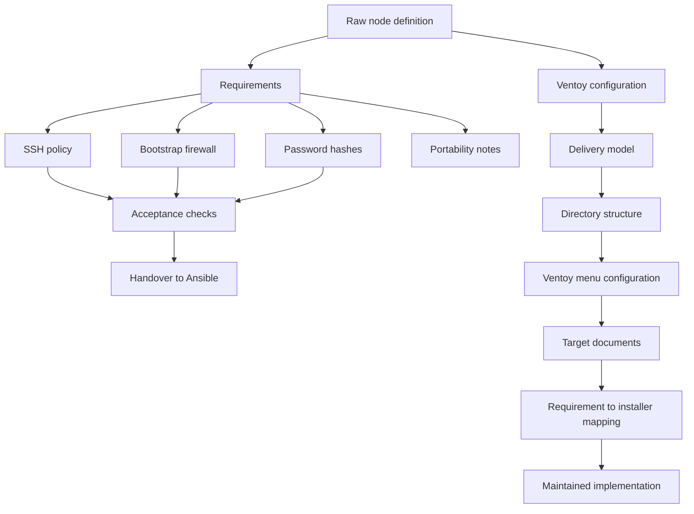

# Ventoy Raw Node Baseline



Some renderers, including GitHub, disable clicks inside Mermaid charts. The same sections are linked here: [Raw node definition](#raw-node-definition), [Requirements](#requirements), [SSH policy](#ssh-policy), [Bootstrap firewall](#bootstrap-firewall), [Password hashes](#password-hashes), [Portability notes](#portability-notes), [Acceptance checks](#acceptance-checks), [Handover to Ansible](#handover-to-ansible), [Ventoy configuration](#ventoy-configuration), [Delivery model](#delivery-model), [Directory structure](#directory-structure), [Ventoy menu configuration](#ventoy-menu-configuration), [Target documents](#target-documents), [Requirement to installer mapping](#requirement-to-installer-mapping), [Maintained implementation](#maintained-implementation), [Change log](#change-log), [References](#references).

This document has two parts. [Raw node definition](#raw-node-definition) states what every freshly installed node must look like, whatever the distribution. [Ventoy configuration](#ventoy-configuration) explains how one Ventoy USB drive delivers that definition to each installer. The per-distribution documents listed under [Target documents](#target-documents) hold the answer files and anything specific to one distribution.

## Raw node definition

### Purpose

A raw node is the state of a machine after the operating system installer finishes and before Ansible runs for the first time. It is deliberately small: just enough to make the node reachable and safe, so that Ansible can take over and build the definitive state.

The rule that decides what belongs here: if Ansible would have to manage a setting anyway, it does not belong in the raw node.

### Requirements

Every target document must satisfy each requirement below and show how in a requirement coverage table.

| ID | Requirement |
| --- | --- |
| RN-01 | A hostname set by the installer. Each target document states its default. |
| RN-02 | Locale `en_CA.UTF-8`, keyboard `us`, time zone `America/Toronto`, network time enabled. |
| RN-03 | A `root` account with a local password, set from a hash. Root cannot log in over SSH. |
| RN-04 | A user named `initial`, with a password set from a hash, in the distribution's administrative group so it can use `sudo`. |
| RN-05 | The operator's SSH public key in `/home/initial/.ssh/authorized_keys`, directory mode `0700`, file mode `0600`, both owned by `initial`. |
| RN-06 | The OpenSSH server installed and listening at boot, whether as a service or through socket activation. |
| RN-07 | The SSH policy drop-in in [SSH policy](#ssh-policy), byte for byte, taking precedence over any other SSH configuration on the node. |
| RN-08 | `nftables` installed, the ruleset in [Bootstrap firewall](#bootstrap-firewall) byte for byte, loaded at boot, and no other firewall manager active. |
| RN-09 | `python3` installed, because Ansible needs Python on the managed node. |
| RN-10 | Storage chosen interactively during installation, until a reliable disk identifier is specified. |
| RN-11 | No plaintext passwords and no private keys anywhere on the installation media. |

The important distinction is that **the firewall allows SSH traffic; SSH then decides whether the connection authenticates with a key or a password.**

### SSH policy

File: `/etc/ssh/sshd_config.d/10-local-auth.conf`

```text
PermitRootLogin no
PubkeyAuthentication yes
PasswordAuthentication yes
KbdInteractiveAuthentication no
UsePAM yes
```

This gives us:

- A local root account with a password.
- No direct SSH login as root.
- SSH key authentication for `initial`.
- SSH password authentication for `initial`.

The `10-` prefix matters. For each keyword, `sshd` uses the first value it reads <a id="cite-openbsd-sshd-config"></a>([OpenBSD, n.d.](#ref-openbsd-sshd-config)). On distributions that include `sshd_config.d/*.conf` at the top of the main file, a drop-in that sorts early wins over both the main file and any later drop-ins, such as one written by cloud-init. Each target document confirms that this holds for its distribution.

### Bootstrap firewall

File: the distribution's `nftables` configuration file, `/etc/nftables.conf` on Debian and Ubuntu.

```text
#!/usr/sbin/nft -f

flush ruleset

table inet filter {
    chain input {
        type filter hook input priority filter;
        policy drop;

        iifname "lo" accept
        ct state invalid drop
        ct state established,related accept

        ip protocol icmp accept
        meta l4proto ipv6-icmp accept

        ip6 saddr fe80::/10 udp sport 547 udp dport 546 accept

        tcp dport 22 ct state new accept
    }

    chain forward {
        type filter hook forward priority filter;
        policy drop;
    }

    chain output {
        type filter hook output priority filter;
        policy accept;
    }
}
```

The ruleset allows new inbound connections on port 22 only. It also accepts loopback traffic, replies to connections the node itself opened (package downloads, DNS), ICMP and ICMPv6, and DHCPv6 replies. None of these opens a new way in. Forwarded traffic is dropped.

A DHCPv6 client sends its request to a multicast address and the server answers by unicast, so connection tracking does not treat the answer as part of an existing connection. The DHCPv6 rule keeps hosts on DHCPv6 networks from losing their IPv6 address. Hosts that use SLAAC only are already covered by the ICMPv6 rule.

`flush ruleset` clears every table in the kernel, including tables that other tools such as Foomuuri, Incus or Docker create. That is acceptable for a bootstrap file that runs before anything else is installed, but it is why `nftables.service` must be disabled when Ansible hands the firewall to Foomuuri. See [Handover to Ansible](#handover-to-ansible).

The bootstrap firewall stays in place even though Ansible replaces it. Each raw node has SSH password authentication enabled, so it needs filtering from first boot until the first Ansible run.

### Password hashes

Install `whois`, which provides `mkpasswd`, on your workstation if necessary, then generate one SHA-512 hash for `root` and one for `initial`:

```sh
sudo apt install whois
mkpasswd --method=sha-512
```

The target documents use the placeholders `ROOT_PASSWORD_HASH`, `INITIAL_PASSWORD_HASH` and `YOUR_SSH_PUBLIC_KEY`. Each explains how its answer file quotes them. The hashes and the public key are still sensitive installation material, so protect the USB drive.

### Portability notes

The requirements are written so that they can hold on any Linux distribution. How each one is met is not. These are the differences known so far. A target document is written for a distribution only once its implementation has been checked.

| Concern | Debian and Ubuntu | Expected on Fedora and Rocky, to be verified |
| --- | --- | --- |
| Administrative group (RN-04) | `sudo` | `wheel` |
| SSH unit (RN-06) | `ssh.service` on Debian, `ssh.socket` on Ubuntu | `sshd.service` |
| `nftables` file (RN-08) | `/etc/nftables.conf` | `/etc/sysconfig/nftables.conf` |
| Competing firewall manager (RN-08) | `ufw` on Ubuntu, installed but inactive | `firewalld`, active by default, must be disabled |
| Installer | Debian Installer preseed, Subiquity autoinstall | Anaconda kickstart |

If a distribution cannot meet a requirement as written, the requirement is reviewed here rather than worked around in one target document.

### Acceptance checks

These checks confirm the raw node. Run them before the first Ansible run. The target documents add distribution-specific checks, such as which SSH unit to inspect.

```sh
sudo -v
sudo id

sudo passwd -S root

sudo sshd -t
sudo sshd -T | grep -E \
  '^(permitrootlogin|passwordauthentication|pubkeyauthentication|kbdinteractiveauthentication) '

sudo nft list ruleset
systemctl is-enabled nftables

python3 --version

sha256sum /etc/ssh/sshd_config.d/10-local-auth.conf /etc/nftables.conf
```

`passwd -S root` should report `P`, meaning root has a usable password. The `sha256sum` output must be identical on every raw node, whatever its distribution.

From another machine:

```sh
# Public key
ssh -o PreferredAuthentications=publickey initial@NODE_IP

# Password
ssh -o PreferredAuthentications=password \
    -o PubkeyAuthentication=no initial@NODE_IP

# Root must be refused
ssh -o PreferredAuthentications=password \
    -o PubkeyAuthentication=no root@NODE_IP
```

Finally, reboot once and repeat `sudo nft list ruleset` to confirm the firewall loads at boot rather than only during installation.

### Handover to Ansible

#### Division of responsibility

| Stage | Responsible for |
| --- | --- |
| Ventoy | Carrying each ISO and its answer file to the installer. Ventoy creates no configuration itself. |
| Answer files | The raw node, as defined by the requirements above. |
| Ansible | The definitive state: the Foomuuri firewall, the final SSH policy, packages, users, roles such as an Incus host, and everything else that must match across nodes. |

Homogeneity across nodes comes from Ansible running the same roles everywhere and continuing to enforce them after the first day, which an installer cannot do. The answer files only need to guarantee what Ansible relies on to connect: the `initial` account with `sudo`, the SSH key, Python, and port 22 reachable.

#### Replacing the bootstrap firewall with Foomuuri

The bootstrap ruleset starts with `flush ruleset`, which clears every table, chain, rule and set in the kernel <a id="cite-canonical-nftables"></a>([Canonical, n.d.](#ref-canonical-nftables)). That includes Foomuuri's rules, so `nftables.service` must not stay enabled once Foomuuri takes over. The Ansible play should follow this order:

1. Install `foomuuri`, deploy the configuration templates and run `foomuuri check` before anything is applied.
2. Enable and start Foomuuri, then confirm that a new SSH connection still succeeds.
3. Remove the bootstrap table with `nft delete table inet filter` and disable the old loader with `systemctl disable nftables`. Optionally replace the bootstrap file with a stub that contains no `flush ruleset`, so a stray restart cannot remove Foomuuri's rules.
4. Reboot once and confirm with `nft list tables` that only Foomuuri's table remains.

Steps 2 and 3 are ordered so that both tables exist briefly. A packet must then be accepted by both, which makes the overlap stricter rather than looser. Access is lost only if the Foomuuri configuration itself drops SSH. For the first rollout, schedule a timed rollback before the cutover, for example with `systemd-run --on-active=5m` re-enabling the bootstrap rules, and cancel it once Ansible reconnects. Alternatively, run the first cutover on an Incus virtual machine with console access.

On hosts that will run Incus or Docker, complete the Foomuuri handover before or together with installing them. Those tools add their own `nftables` tables, and the bootstrap `flush ruleset` would remove them on any restart of `nftables.service`.

#### Foomuuri versions

The packaged Foomuuri version differs by distribution:

| Release | Package |
| --- | --- |
| Ubuntu 24.04 | 0.22, universe component <a id="cite-ubuntu-packages-foomuuri"></a>([Ubuntu, n.d.](#ref-ubuntu-packages-foomuuri)) |
| Debian 13 | 0.27, with 0.31 in trixie-backports <a id="cite-debian-sources-foomuuri"></a>([Debian Project, n.d.](#ref-debian-sources-foomuuri)) |
| Ubuntu 26.04 | Check the archive before writing the role |

One Ansible template may not behave the same on 0.22 and 0.31. Either pin one version on every node (backports on Debian, an upstream or locally built package on Ubuntu), or write the configuration against the oldest version deployed and test it on each release. On Ubuntu, the universe component receives community rather than Canonical security maintenance, so confirm that security fixes have reached the version in use.

On servers, do not install `foomuuri-firewalld` or enable the D-Bus service. Zone switching driven by NetworkManager is only useful on desktops.

#### Optional tighter bootstrap

A stricter variant would install with key-only SSH (`PasswordAuthentication no` in the drop-in, and `allow-pw: false` on Ubuntu), and let Ansible enable password authentication once Foomuuri is in place. This removes password logins from the window between first boot and the first Ansible run. It is not adopted in this version, because the raw node as specified includes password authentication from the start.

## Ventoy configuration

### Delivery model

Ventoy does not create any part of the raw node. It boots the selected ISO and hands the installer an answer file, which Ventoy calls a template. The answer file is what builds the raw node, using each installer's own mechanism: a `late_command` in a Debian preseed file, `late-commands` in Ubuntu autoinstall. The mechanisms differ, but the files they write are the canonical files above, byte for byte.

A raw node can therefore be produced only for installers that support unattended installation and for which a target document exists. Each new distribution needs its own target document and answer file that writes the same files.

### Directory structure

On the Ventoy data partition:

```text
/
├── ISO/
│   ├── debian/
│   │   └── debian-13.N.N-amd64-netinst.iso
│   └── ubuntu/
│       ├── ubuntu-24.04.5-live-server-amd64.iso
│       └── ubuntu-26.04.N-live-server-amd64.iso
│
└── ventoy/
    ├── ventoy.json
    └── answer-files/
        ├── debian-13-preseed.cfg
        ├── ubuntu-24.04-user-data
        └── ubuntu-26.04-user-data
```

Replace `N` with the point release you download, and keep `ventoy.json` in step with the actual filenames.

### Ventoy menu configuration

File: `/ventoy/ventoy.json`

```json
{
  "auto_install": [
    {
      "image": "/ISO/debian/debian-13.N.N-amd64-netinst.iso",
      "template": "/ventoy/answer-files/debian-13-preseed.cfg"
    },
    {
      "image": "/ISO/ubuntu/ubuntu-24.04.5-live-server-amd64.iso",
      "template": "/ventoy/answer-files/ubuntu-24.04-user-data"
    },
    {
      "image": "/ISO/ubuntu/ubuntu-26.04.N-live-server-amd64.iso",
      "template": "/ventoy/answer-files/ubuntu-26.04-user-data"
    }
  ]
}
```

`auto_install` maps each ISO, or a whole parent directory, to one or more answer files, and `autosel` can preselect one of them <a id="cite-ventoy-autoinstall"></a>([Ventoy, n.d.](#ref-ventoy-autoinstall)). `autosel` is deliberately omitted. Ventoy then asks at boot whether to use an answer file, which protects against accidentally starting an unattended installation.

Because one ISO can carry several answer files, role variants do not need a second ISO. A planned Debian 13 Incus host variant, for example, would become a second entry in the Debian `template` list once its partitioning is automated. Until then, the role is given by Ansible.

### Target documents

| Distribution | Installer | Document | Status |
| --- | --- | --- | --- |
| Debian 13 "trixie" | Debian Installer, preseed | `ventoy-automated-configuration-for-debian-13-server-v0.2.0.md` | Reviewed, not yet tested in a virtual machine |
| Ubuntu Server 26.04 LTS | Subiquity, autoinstall | `ventoy-automated-configuration-for-ubuntu-26.04-server-v0.2.0.md` | Reviewed, not yet tested in a virtual machine |
| Ubuntu Server 24.04 LTS | Subiquity, autoinstall | `ventoy-automated-configuration-for-ubuntu-24.04-server-v0.2.0.md` | Reviewed, not yet tested in a virtual machine |
| Fedora Server, Rocky Linux | Anaconda, kickstart | Not started | See [Portability notes](#portability-notes) |

Target documents are added one distribution at a time. A distribution counts as supported once its acceptance checks pass and its `sha256sum` output matches the other raw nodes.

### Requirement to installer mapping

| ID | Debian preseed | Ubuntu autoinstall |
| --- | --- | --- |
| RN-01 | `netcfg/hostname` | `identity.hostname` |
| RN-02 | `debian-installer/locale`, `keyboard-configuration/xkb-keymap`, `time/zone`, `clock-setup/ntp` | `locale`, `keyboard`, `timezone` |
| RN-03 | `passwd/root-password-crypted` | `usermod --password` in `late-commands` |
| RN-04 | `passwd/user-password-crypted`, `usermod -aG sudo` in `late_command` | `identity` (default groups include `sudo`) |
| RN-05 | `late_command` | `ssh.authorized-keys` |
| RN-06 | `tasksel` `ssh-server` | `ssh.install-server` |
| RN-07 | `late_command`, base64 payload | `late-commands`, heredoc |
| RN-08 | `pkgsel/include`, `late_command`, `systemctl enable nftables` | `packages`, `late-commands`, `systemctl enable nftables` |
| RN-09 | `pkgsel/include` | `packages` |
| RN-10 | Partitioning not preseeded | `interactive-sections: [storage]` |
| RN-11 | Hashes only | Hashes only |

### Maintained implementation

Keep the canonical files in one repository and generate every answer file from them, so the raw node is defined once.

```text
server-install/
├── README.md
├── shared/
│   ├── ssh/
│   │   └── 10-local-auth.conf
│   └── nftables/
│       └── nftables.conf
├── debian/
│   └── debian-13-preseed.cfg.in
├── ubuntu/
│   ├── ubuntu-24.04-user-data.in
│   └── ubuntu-26.04-user-data.in
├── ventoy/
│   └── ventoy.json
└── bin/
    └── build-install-media.py
```

The build script reads the canonical files, inserts them into each template (as base64 for Debian, as heredocs for Ubuntu), inserts the public key and password hashes from protected local inputs, writes the Ventoy files and validates the output: `debconf-set-selections -c` for the preseed file, YAML parsing for each `user-data`, JSON parsing for `ventoy.json`, `nft -c -f` for the ruleset and `sshd -t` for the SSH drop-in. It never writes private keys or plaintext passwords.

The Ansible roles that take over from the raw node, including the Foomuuri role, belong in their own repository.

### Qualification

These are reviewed configuration templates, not yet a tested turnkey installer. Validate each target in an Incus virtual machine before using it on physical hardware, especially account creation, the root password, the SSH configuration and firewall activation at boot.

## Change log

### 0.2.0, 2026-11-14

- New document. Splits the distro-agnostic content out of `ventoy-automated-configuration-for-debian-and-ubuntu-26.04-v0.1.2.md`, which this document and the three target documents replace.
- Added the raw node definition with numbered requirements RN-01 to RN-11, portability notes and a requirement to installer mapping.
- Added RN-09: `python3` must be installed for Ansible. The answer files now request it explicitly.
- Moved the canonical SSH and firewall files, password hashes, acceptance checks and the handover to Ansible here from the target documents.
- Combined the Ventoy layout and menu for all three targets.

## References

<a id="ref-canonical-nftables"></a>
Canonical. (n.d.). *nftables*. Ubuntu security documentation. Retrieved November 14, 2026, from https://documentation.ubuntu.com/security/security-features/network/firewall/nftables/
[Return to citation](#cite-canonical-nftables)

<a id="ref-debian-sources-foomuuri"></a>
Debian Project. (n.d.). *Package: foomuuri*. Debian sources. Retrieved November 14, 2026, from https://sources.debian.org/patches/foomuuri
[Return to citation](#cite-debian-sources-foomuuri)

<a id="ref-openbsd-sshd-config"></a>
OpenBSD. (n.d.). *sshd_config(5): OpenSSH daemon configuration file*. OpenBSD manual pages. Retrieved November 14, 2026, from https://man.openbsd.org/sshd_config
[Return to citation](#cite-openbsd-sshd-config)

<a id="ref-ubuntu-packages-foomuuri"></a>
Ubuntu. (n.d.). *Package: foomuuri (0.22-1) [universe], noble (24.04LTS)*. Ubuntu packages. Retrieved November 14, 2026, from https://packages.ubuntu.com/noble/foomuuri
[Return to citation](#cite-ubuntu-packages-foomuuri)

<a id="ref-ventoy-autoinstall"></a>
Ventoy. (n.d.). *Auto installation plugin*. Retrieved November 14, 2026, from https://www.ventoy.net/en/plugin_autoinstall.html
[Return to citation](#cite-ventoy-autoinstall)
