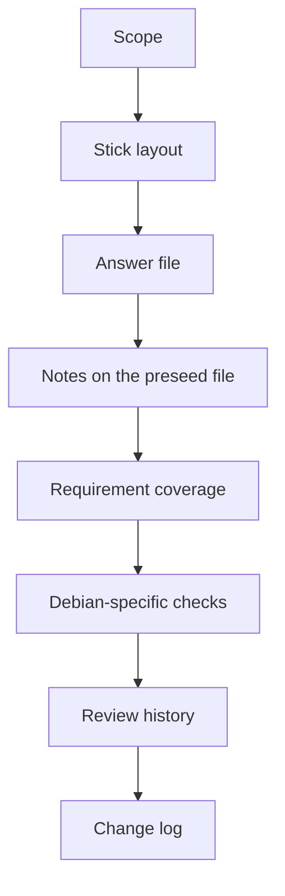

# Ventoy Automated Configuration for Debian 13 Server



Some renderers, including GitHub, disable clicks inside Mermaid charts. The same sections are linked here: [Scope](#scope), [Stick layout](#stick-layout), [Answer file](#answer-file), [Notes on the preseed file](#notes-on-the-preseed-file), [Requirement coverage](#requirement-coverage), [Debian-specific checks](#debian-specific-checks), [Review history](#review-history), [Change log](#change-log), [References](#references).

## Scope

- Debian 13 "trixie", the current Debian stable release <a id="cite-debian-example-preseed"></a>([Debian Project, n.d.-c](#ref-debian-example-preseed)), installed from the netinst ISO with the Debian Installer and a preseed answer file.
- The result is the raw node defined in [raw-node-baseline.md](raw-node-baseline.md), which holds the requirements (RN-01 to RN-12), the inputs, the canonical files, the general acceptance checks and the handover to Ansible. This document holds only what is specific to Debian 13.
- The installer hostname is `deb13-vt`, which becomes `deb13-vt-xxxx` at first boot.
- A Debian 13 Incus host variant is planned. It will become a second answer file for the same ISO folder once its partitioning is automated. Until then, the Incus host role is given by Ansible.

## Stick layout

```text
/iso/debian/13/debian-13.7.0-amd64-netinst.iso
/answer-files/debian/13/preseed.cfg
```

`bin/build --stick` writes the answer file and the `ventoy.json` entry, which matches the folder `/iso/debian/13` rather than the ISO filename. See [ISO downloads](iso-downloads.md) for fetching and verifying the ISO.

## Answer file

Template: [`debian/13/preseed.cfg.j2`](../../debian/13/preseed.cfg.j2). `bin/build` renders it into `build/answer-files/debian/13/preseed.cfg`, filling in the [inputs](raw-node-baseline.md#inputs) and embedding the [canonical files](raw-node-baseline.md#canonical-files).

The file answers, in order: localization, network and hostname, mirror, clock and time zone, the root account, the initial user, package selection (`standard`, `ssh-server`, plus `sudo`, `nftables`, `python3` and `foomuuri`), and the boot loader. Partitioning is deliberately left unanswered. A single `late_command` then completes the raw node: it adds the initial user to `sudo`, installs the SSH key, writes the canonical files, masks `nftables.service` and enables `foomuuri.service` and `raw-node-firstboot.service`.

Each canonical file is written with `printf`, one single-quoted argument per line, so the rendered answer file stays readable:

```text
    mkdir -p /target/etc/ssh/sshd_config.d; \
    printf '%s\n' \
        'PermitRootLogin no' \
        'PubkeyAuthentication yes' \
        'PasswordAuthentication yes' \
        'KbdInteractiveAuthentication no' \
        'UsePAM yes' \
        > /target/etc/ssh/sshd_config.d/10-local-auth.conf; \
    chmod 0644 /target/etc/ssh/sshd_config.d/10-local-auth.conf; \
```

## Notes on the preseed file

`late_command` runs just before the installation finishes, while the new system is still mounted at `/target`, and `in-target` runs a command inside that system <a id="cite-debian-b5"></a>([Debian Project, n.d.-b](#ref-debian-b5)). The installer joins the backslash-continued lines of `late_command` into one long line before running it, so a heredoc cannot work there. `printf '%s\n'` with one argument per line produces the same file without any escaping, provided no line contains a single quote. `bin/build` enforces that rule and re-extracts every file to prove it arrives byte for byte.

A preconfiguration file should begin with `#_preseed_V1`, and its syntax can be checked with `debconf-set-selections -c` <a id="cite-debian-b3"></a>([Debian Project, n.d.-a](#ref-debian-b3)). `bin/build` runs that check when the tool is installed. On a workstation, debconf reports the installer's own questions, such as `passwd/root-password-crypted`, as unknown. That is expected, and the build ignores those messages while still failing on real syntax errors.

The firewall is Foomuuri 0.27 from Debian's main archive, which pulls in `nftables` as a dependency. The package does not enable its service, so `late_command` enables `foomuuri.service`. That unit is ordered before `network-pre.target`, and ifupdown brings the interfaces up after that target, so the rules are in force before the network. It also starts `foomuuri-boot.service`, which loads the last good ruleset earlier still from the second boot on. `foomuuri-boot.service` has no install section, so it is not enabled separately. Debian ships `nftables.service` disabled <a id="cite-hertzog-mas-firewall"></a>([Hertzog & Mas, n.d.](#ref-hertzog-mas-firewall)), and `late_command` masks it as well, because its stop action flushes every table, Foomuuri's included. Debian installs no other firewall manager by default, and it has no cloud-init, so the packaged `foomuuri.service` is used unchanged.

`ssh.service` is already enabled by the `openssh-server` package. It reads `Port` from `/etc/ssh/sshd_config.d/20-raw-node-port.conf`.

The rendered `late_command` is about 19 kB once the installer has joined its lines, roughly twice the size that passed on metal with baseline 0.2.0, mostly because of the longer report script. The installer's parser has no fixed limit in its source, but the first installation with this baseline should confirm it.

`netcfg/get_hostname` is only a fallback when DHCP does not supply a name, so `netcfg/hostname` forces `deb13-vt` regardless of DHCP. The domain is `home.arpa` because `.local` is reserved for Multicast DNS <a id="cite-rfc6762"></a>([Cheshire & Krochmal, 2013](#ref-rfc6762)), and `home.arpa` is the name set aside for residential and small networks <a id="cite-rfc8375"></a>([Pfister & Lemon, 2018](#ref-rfc8375)). At first boot, `raw-node-firstboot` replaces `deb13-vt` with the suffixed name in both `/etc/hostname` and `/etc/hosts`, including the `deb13-vt.home.arpa` entry.

`python3` is listed in `pkgsel/include` so that RN-09 does not depend on what the `standard` task happens to pull in.

Language and keyboard may still be asked before the preseed file is read, depending on how the installer receives it. Watch for this in the virtual machine test.

## Requirement coverage

| ID | How this answer file meets it |
| --- | --- |
| RN-01 | `netcfg/hostname` set to `deb13-vt`; suffix added by `raw-node-firstboot` |
| RN-02 | `debian-installer/locale`, `keyboard-configuration/xkb-keymap`, `time/zone`, `clock-setup/ntp` |
| RN-03 | `passwd/root-login` and `passwd/root-password-crypted`; root SSH login refused by the drop-in |
| RN-04 | `passwd/username` and `passwd/user-password-crypted`; `usermod -aG sudo` in `late_command` |
| RN-05 | `install -d -m 0700`, `printf` and `chmod 0600` in `late_command` |
| RN-06 | `tasksel` `ssh-server`; `ssh.service` enabled by the package; `Port` from `20-raw-node-port.conf` |
| RN-07 | `printf` writes `/etc/ssh/sshd_config.d/10-local-auth.conf` and `20-raw-node-port.conf`; Debian includes `sshd_config.d/*.conf` at the top of `sshd_config` |
| RN-08 | `foomuuri` in `pkgsel/include`; `printf` writes `/etc/foomuuri/00-raw-node.conf`; `systemctl mask nftables.service`; `systemctl enable foomuuri.service` |
| RN-09 | `python3` in `pkgsel/include` |
| RN-10 | Partitioning not preseeded, so the partitioner stops for confirmation |
| RN-11 | Only crypt hashes and the public key appear in the file |
| RN-12 | `printf` writes the report scripts, unit and `raw-node.conf`; `systemctl enable raw-node-firstboot.service` |

## Debian-specific checks

Run the baseline [acceptance checks](raw-node-baseline.md#acceptance-checks), then:

```sh
systemctl status ssh
systemctl status foomuuri foomuuri-boot
journalctl -b -u foomuuri -u networking
hostnamectl --static
grep 127.0.1.1 /etc/hosts
```

`ssh.service` should be active and enabled. `foomuuri.service` should be active, and in the journal it should start before `networking.service`. `foomuuri-boot.service` is skipped at first boot and active from the second boot on. The hostname should be `deb13-vt-` followed by four hexadecimal digits, and the `127.0.1.1` line in `/etc/hosts` should carry the same name.

## Review history

| Item | Status | Detail |
| --- | --- | --- |
| SSH base64 payload | Fixed in 0.1.1 | The 0.1.0 payload was corrupted partway through `KbdInteractiveAuthentication`. |
| `ssh.service` enable | Removed in 0.1.1 | Already enabled by `openssh-server`. |
| Domain `local` | Changed in 0.1.1 | Replaced with `home.arpa`. |
| Hostname | Changed in 0.1.1 | Added `netcfg/hostname` so DHCP cannot override it. |
| File header, mirror, popularity-contest | Added in 0.1.1 | `#_preseed_V1`, mirror answers and a popularity-contest answer, to avoid stray prompts. |
| `debconf/priority` | Removed in 0.1.1 | Priority is normally set on the kernel command line. |
| `python3` | Added in 0.2.0 | Requested explicitly for RN-09. |
| Base64 embedding | Replaced in 0.3.0 | Canonical files are written with readable `printf` lines. |
| Hostname | Changed in 0.3.0 | `deb13-vt` plus a MAC suffix at first boot, replacing `debian-server`. |
| First-boot report | Added in 0.3.0 | RN-12. |
| Firewall | Replaced in 0.3.0 | Foomuuri with `/etc/foomuuri/00-raw-node.conf` instead of `/etc/nftables.conf`. `nftables.service` masked. |
| SSH port | Added in 0.3.0 | `20-raw-node-port.conf`, from the `ssh_port` input. |

## Qualification

This is a reviewed configuration template, not yet a tested turnkey installer. Validate it in an Incus virtual machine before using it on physical hardware.

## Change log

### 0.3.0, 2026-11-15

- Firewall changed to Foomuuri: `foomuuri` added to the packages, `/etc/foomuuri/00-raw-node.conf` written instead of `/etc/nftables.conf`, `nftables.service` masked, `foomuuri.service` enabled.
- SSH port drop-in written from the `ssh_port` input.
- The confirmation follows the raw node contract 0.1.0. See [contracts.md](contracts.md).

### 0.3.0, 2026-11-14

- The answer file is now rendered by `bin/build` from [`debian/13/preseed.cfg.j2`](../../debian/13/preseed.cfg.j2) and is linked rather than copied here.
- Replaced base64 embedding with `printf`, removed the regeneration instructions and the placeholder substitution steps.
- New stick paths: `/iso/debian/13/` and `/answer-files/debian/13/preseed.cfg`.
- Hostname `deb13-vt` with a first-boot MAC suffix; added RN-12 coverage and checks for it.
- Renamed from `ventoy-automated-configuration-for-debian-13-server-v0.2.0.md`; versions are tracked in the front matter.

### Earlier versions

- 0.2.0: split from the combined document, `python3` added, requirement coverage table added.
- 0.1.0 to 0.1.2: Debian and Ubuntu covered together in one combined document.

## References

<a id="ref-rfc6762"></a>
Cheshire, S., & Krochmal, M. (2013). *Multicast DNS* (RFC 6762). RFC Editor. https://doi.org/10.17487/RFC6762
[Return to citation](#cite-rfc6762)

<a id="ref-debian-b3"></a>
Debian Project. (n.d.-a). B.3. Creating a preconfiguration file. In *Debian GNU/Linux installation guide: trixie, amd64*. Retrieved November 14, 2026, from https://www.debian.org/releases/trixie/amd64/apbs03.en.html
[Return to citation](#cite-debian-b3)

<a id="ref-debian-b5"></a>
Debian Project. (n.d.-b). B.5. Advanced options. In *Debian GNU/Linux installation guide: trixie, amd64*. Retrieved November 14, 2026, from https://www.debian.org/releases/trixie/amd64/apbs05.en.html
[Return to citation](#cite-debian-b5)

<a id="ref-debian-example-preseed"></a>
Debian Project. (n.d.-c). *Example preconfiguration file (for trixie)*. Retrieved November 14, 2026, from https://www.debian.org/releases/stable/example-preseed.txt
[Return to citation](#cite-debian-example-preseed)

<a id="ref-hertzog-mas-firewall"></a>
Hertzog, R., & Mas, R. (n.d.). Firewall or packet filtering. In *The Debian administrator's handbook*. Retrieved November 14, 2026, from https://www.debian.org/doc/manuals/debian-handbook/sect.firewall-packet-filtering.en.html
[Return to citation](#cite-hertzog-mas-firewall)

<a id="ref-rfc8375"></a>
Pfister, P., & Lemon, T. (2018). *Special-use domain 'home.arpa.'* (RFC 8375). RFC Editor. https://doi.org/10.17487/RFC8375
[Return to citation](#cite-rfc8375)
