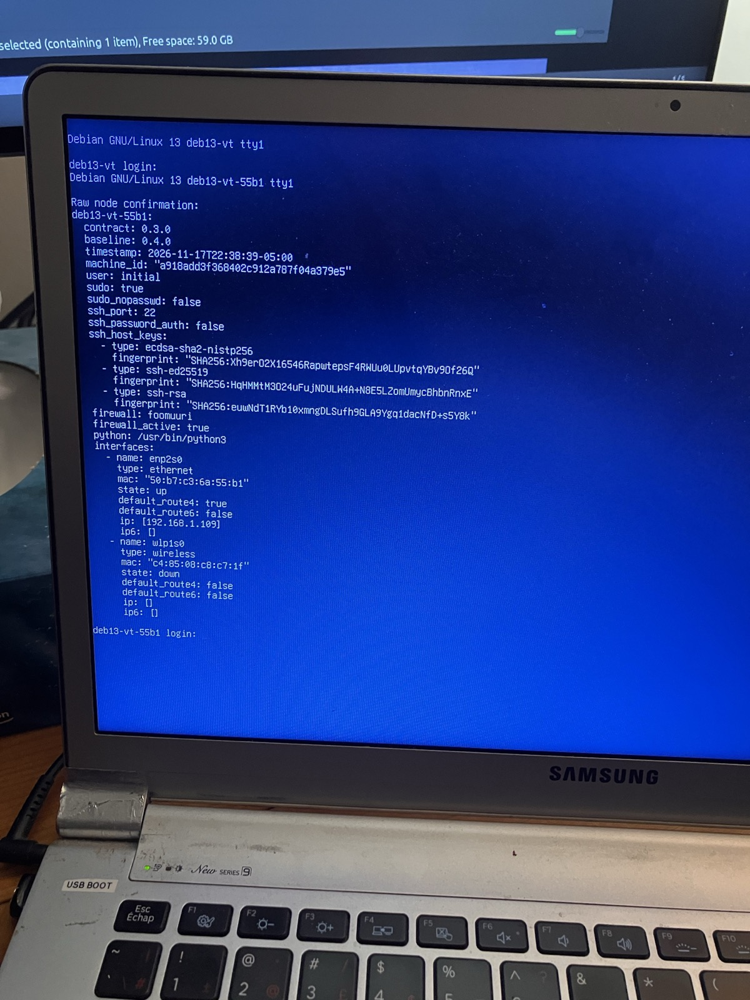

# uc-ventoy-post-raw-node-install-confirmation and testing

## First boot after installation




That's a good install. The confirmation shows everything 0.3.0 promises: `sudo_nopasswd: false`, `ssh_password_auth: false`, three host keys with fingerprints, and `mac` and `machine_id` quoted. It reports contract 0.3.0 with baseline 0.4.0, which the updated admission kickoff accepts. There's no need to rebuild for 0.3.1 just for phase 4.

Now run the checks on it. One thing first: your workstation remembers this address from the previous install, which had different host keys, so SSH will refuse with "REMOTE HOST IDENTIFICATION HAS CHANGED". Remove the old entry:

```bash
ssh-keygen -R 192.168.1.109
```

### From the workstation:

#### Host keys: compare with the photo. The ed25519 line should end in ...RnxE

```bash
ssh-keyscan 192.168.1.109 2>/dev/null | ssh-keygen -l -f -
```

Output example:

```bash
256 SHA256:HqHMMtM3O24uFujNDULW4A+N8E5LZomUmycBhbnRnxE 192.168.1.109 (ED25519)
3072 SHA256:euwNdT1RYb10xmngDLSufh9GLA9Ygq1dacNfD+s5Y8k 192.168.1.109 (RSA)
256 SHA256:Xh9erO2X16546RapwtepsF4RWUu0LUpvtqYBv9Of26Q 192.168.1.109 (ECDSA)
```

#### Key login works


```bash
ssh -i ~/.ssh/gradus-raw-initial-id_ed25519 -o PreferredAuthentications=publickey initial@192.168.1.109 true && echo key-ok
```

Output example:

```bash
The authenticity of host '192.168.1.109 (192.168.1.109)' can't be established.
ED25519 key fingerprint is SHA256:HqHMMtM3O24uFujNDULW4A+N8E5LZomUmycBhbnRnxE.
This key is not known by any other names.
Are you sure you want to continue connecting (yes/no/[fingerprint])? yes

key-ok
```

#### Password login is refused, with no password prompt, for initial and root

##### initial user

```bash
ssh -o PreferredAuthentications=password,keyboard-interactive -o PubkeyAuthentication=no initial@192.168.1.109 true
```

Output example:

```bash
initial@192.168.1.109: Permission denied (publickey).
```

#### root user

```bash
ssh -o PreferredAuthentications=password,keyboard-interactive -o PubkeyAuthentication=no root@192.168.1.109 true
```

Output example:

```bash
root@192.168.1.109: Permission denied (publickey).
```

#### sudo asks for the batch password

```bash
ssh -t initial@192.168.1.109 'sudo -k; sudo true && echo sudo-ok'
```

Output example:

```bash
[sudo] password for initial: 
Sorry, try again.
[sudo] password for initial: 
sudo-ok
Connection to 192.168.1.109 closed.
```

#### Troubleshooting

Add `-i ~/.ssh/<your key>` to the `ssh` lines if the key isn't your default. Both password attempts should end with "Permission denied (publickey)".

### At the raw nodes console

log in as `initial` with the batch password. This checks that console login still works (RN-ACC-06).

Confirm that sudo works for the initial user

```bash
initial@deb13-vt-55b1:~$ sudo ls -al 
```

Keep the photo. When phase 4 runs, the ed25519 fingerprint on screen is what you pass as `admit_expected_fingerprint`. Copy it from the keyscan output rather than retyping it from the photo, where O and 0 are easy to confuse. If the keyscan output and the photo agree, the out-of-band check has done its job.