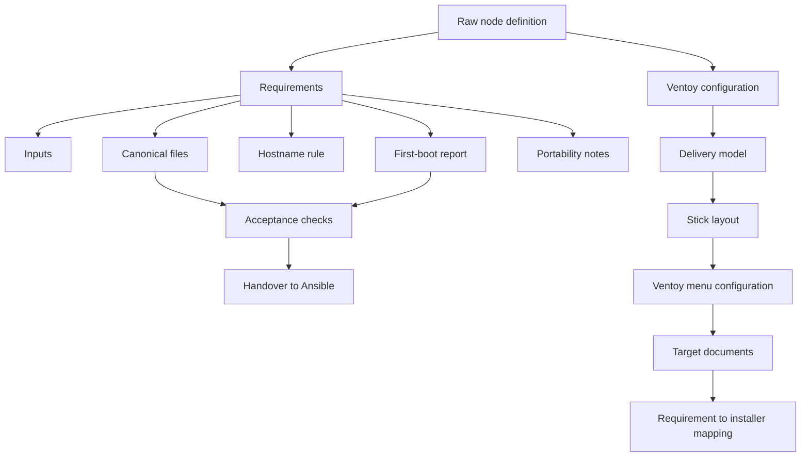

# Ventoy Raw Node Baseline



Some renderers, including GitHub, disable clicks inside Mermaid charts. The same sections are linked here: [Raw node definition](#raw-node-definition), [Requirements](#requirements), [Inputs](#inputs), [Canonical files](#canonical-files), [Hostname rule](#hostname-rule), [First-boot report](#first-boot-report), [Portability notes](#portability-notes), [Acceptance checks](#acceptance-checks), [Handover to Ansible](#handover-to-ansible), [Ventoy configuration](#ventoy-configuration), [Delivery model](#delivery-model), [Stick layout](#stick-layout), [Ventoy menu configuration](#ventoy-menu-configuration), [Target documents](#target-documents), [Requirement to installer mapping](#requirement-to-installer-mapping), [Change log](#change-log), [References](#references).

This document has two parts. [Raw node definition](#raw-node-definition) states what every freshly installed node must look like, whatever the distribution. [Ventoy configuration](#ventoy-configuration) explains how one Ventoy USB drive delivers that definition to each installer. The target documents hold what is specific to one distribution. The files themselves live in the repository and are linked rather than copied here, so the documents cannot drift from what is actually installed.

## Raw node definition

### Purpose

A raw node is the state of a machine after the operating system installer finishes and before Ansible runs for the first time. It is deliberately small: just enough to make the node reachable and safe, so that Ansible can take over and build the definitive state.

The rule that decides what belongs here: if Ansible would have to manage a setting anyway, it does not belong in the raw node.

What Ansible may rely on when it receives a raw node is fixed by the raw node contract, which uc-ventoy implements as a producer. [contracts.md](contracts.md) records the contract version and how each clause is met. The requirements below are uc-ventoy's own and are wider than the contract.

### Requirements

Every target document must satisfy each requirement below and show how in a requirement coverage table.

| ID | Requirement |
| --- | --- |
| RN-01 | A hostname following the [Hostname rule](#hostname-rule). |
| RN-02 | Locale `en_CA.UTF-8`, keyboard `us`, time zone `America/Toronto`, network time enabled. |
| RN-03 | A `root` account with a local password, set from a hash. Root cannot log in over SSH. |
| RN-04 | An initial user, named by the input (default `initial`), with a password set from a hash made by the Ansible controller, in the distribution's administrative group so it can use `sudo`. sudo asks for that password: no sudoers rule for the user, and no `NOPASSWD` or `!authenticate` anywhere. The password works at the console and for sudo, not over SSH. |
| RN-05 | The operator's SSH public key in the initial user's `~/.ssh/authorized_keys`, directory mode `0700`, file mode `0600`, both owned by that user. |
| RN-06 | The OpenSSH server installed and listening at boot on the port given by the input, whether as a service or through socket activation. |
| RN-07 | The canonical SSH policy drop-in, byte for byte, taking precedence over any other SSH configuration on the node, and a second drop-in that sets the port. SSH accepts public keys only. |
| RN-08 | Foomuuri installed, with the canonical firewall file byte for byte as its only configuration, in force before the network comes up. `nftables.service` masked, and no other firewall manager active. |
| RN-09 | `python3` installed, because Ansible needs Python on the managed node. |
| RN-10 | Storage chosen interactively during installation, until a reliable disk identifier is specified. |
| RN-11 | No plaintext passwords and no private keys anywhere on the installation media. |
| RN-12 | The [First-boot report](#first-boot-report) installed and enabled, so that the node writes `/var/lib/raw-node/confirmation.yml` once at first boot, in the format of the raw node contract. |

The important distinction is that **the firewall allows SSH traffic; SSH then accepts a key and nothing else.** The initial user's password is for the console and for sudo.

### Inputs

A raw node needs four values, and takes three optional ones. They live in `raw-node-input.yml` at the repository root, which is git-ignored because it holds password hashes. [`raw-node-input.example.yml`](../../raw-node-input.example.yml) documents the format.

| Key | Required | Meaning |
| --- | --- | --- |
| `root_password_hash` | Yes | Crypt hash for `root` (RN-03) |
| `initial_username` | Yes | Name of the initial user (RN-04) |
| `initial_password_hash` | Yes | SHA-512 crypt hash of the batch password for the initial user (RN-04), from the Ansible controller |
| `ssh_public_key` | Yes | One OpenSSH public key line (RN-05) |
| `ssh_port` | No, default 22 | The port sshd listens on and the firewall opens (RN-06, RN-08). A whole number from 1 to 65535. |
| `ssh_sources` | No, default empty | The addresses or networks allowed to reach SSH (RN-08). Empty means any. Each entry is an IPv4 or IPv6 address or network. A bare address means one host, and host bits are refused, so `192.0.2.1/24` is an error. |
| `password_batch` | No | The batch ID the controller printed with `initial_password_hash`, such as `raw-2026-11-17-manual`. Letters, digits, dots, hyphens and underscores, at most 64. Written to `raw-node.conf` as `RAW_NODE_PASSWORD_BATCH` so that an operator at the console can tell which batch password the node has. Not part of the contract or the confirmation. |

The two password hashes come from different places:

- `root_password_hash` belongs to this producer. Generate it with `mkpasswd --method=sha-512` (package `whois`). The controller never needs the `root` password.
- `initial_password_hash` is the hash of the contract's shared parameter `initial_password`, which the Ansible controller holds. The controller makes a batch password with `scripts/new_raw_batch.py` in uc-controller, keeps it in its secret store, and prints the batch ID and a SHA-512 hash. Copy both into `raw-node-input.yml`. The plain password never enters uc-ventoy, and nothing here accepts it. See [contracts.md](contracts.md#the-initial-password) for the details, including how to make a batch by hand until the script exists.

Everything else is a constant of the baseline, and the distribution is chosen from the Ventoy menu at boot. `bin/build` rejects missing, malformed or dummy values before anything is rendered.

`initial_username`, `ssh_public_key`, `ssh_port` and `ssh_sources` are shared parameters of the raw node contract, so the Ansible controller must be given the same values. The fifth, `initial_password`, is the controller's own, and reaches uc-ventoy only as `initial_password_hash`. With only IPv4 entries in `ssh_sources`, SSH over IPv6 is closed, and the other way round.

### Canonical files

These files are written identically on every raw node. `bin/build` embeds them in each answer file and then extracts them again to prove they arrive byte for byte with the right permissions.

| Source in the repository | Path on the node | Mode |
| --- | --- | --- |
| [`shared/ssh/10-local-auth.conf`](../../shared/ssh/10-local-auth.conf) | `/etc/ssh/sshd_config.d/10-local-auth.conf` | `0644` |
| Generated by `bin/build` | `/etc/ssh/sshd_config.d/20-raw-node-port.conf` (`Port`, from `ssh_port`) | `0644` |
| Rendered once by `bin/build` from [`shared/foomuuri/00-raw-node.conf.j2`](../../shared/foomuuri/00-raw-node.conf.j2) | `/etc/foomuuri/00-raw-node.conf` | `0644` |
| [`shared/bin/raw-node-report`](../../shared/bin/raw-node-report) | `/usr/local/sbin/raw-node-report` | `0755` |
| [`shared/bin/raw-node-firstboot`](../../shared/bin/raw-node-firstboot) | `/usr/local/sbin/raw-node-firstboot` | `0755` |
| [`shared/systemd/raw-node-firstboot.service`](../../shared/systemd/raw-node-firstboot.service) | `/etc/systemd/system/raw-node-firstboot.service` | `0644` |
| Generated by `bin/build` | `/etc/raw-node/raw-node.conf` (user name, target, baseline version, contract version, and the password batch ID when `password_batch` is set) | `0644` |
| [`shared/cloud-init/99-raw-node.cfg`](../../shared/cloud-init/99-raw-node.cfg), cloud-init targets only | `/etc/cloud/cloud.cfg.d/99-raw-node.cfg` | `0644` |
| [`shared/systemd/foomuuri-raw-node.conf`](../../shared/systemd/foomuuri-raw-node.conf), cloud-init targets only | `/etc/systemd/system/foomuuri.service.d/10-raw-node.conf` | `0644` |

#### SSH policy

The policy drop-in disables root login over SSH and allows public key authentication only: `PasswordAuthentication no`, `KbdInteractiveAuthentication no` and `PermitEmptyPasswords no`. `UsePAM yes` stays, so PAM still handles accounts and sessions, and the console login and sudo, which do not go through sshd, keep using the password. The port drop-in holds one `Port` line, written even when the port is 22, so the port a node listens on is never implied. On Ubuntu, where `ssh.socket` does the listening, `sshd-socket-generator` reads the same configuration at boot and gives the socket the same port. The `10-` prefix matters. For each keyword, `sshd` uses the first value it reads <a id="cite-openbsd-sshd-config"></a>([OpenBSD, n.d.](#ref-openbsd-sshd-config)). On distributions that include `sshd_config.d/*.conf` at the top of the main file, a drop-in that sorts early wins over both the main file and any later drop-ins, such as one written by cloud-init. The stock `sshd_config` of Debian 13, Ubuntu 24.04 and Ubuntu 26.04 has the `Include` as its first setting, and each target's own `sshd -G` reports `passwordauthentication no` even with a later drop-in that says `yes`. On Ubuntu the answer file also sets `allow-pw: false`, so cloud-init's `50-cloud-init.conf` says `no` as well and the two files agree.

#### Firewall

Every raw node runs Foomuuri, which owns one nftables table, `inet foomuuri`. Its whole configuration is `/etc/foomuuri/00-raw-node.conf`. `bin/build` renders that file once and embeds the same text in every answer file, so the rules do not differ between targets.

| Direction | Accepted |
| --- | --- |
| In, from the `public` zone | SSH on `ssh_port` from `ssh_sources`, or from anywhere when the list is empty. DHCP and DHCPv6 replies, ping, and the ICMP and ICMPv6 that networking needs, which Foomuuri adds by itself. |
| Out, to the `public` zone | Everything |
| Forwarded | Nothing |

The `public` zone holds the interfaces named `en*` (wired), `eth*` (virtual machines and containers) and `wl*` (wireless). Foomuuri's catch-all `*` would be simpler, but it needs Foomuuri 0.33 or later and the targets ship 0.22, 0.27 and 0.31, where it produces rules that `nft` rejects. An interface with any other name is in no zone: nothing comes in through it and nothing goes out through it.

Around Foomuuri:

- `foomuuri.service` is enabled. It is ordered before `network-pre.target`, so the rules are in force before the network comes up. On Debian 13 and Ubuntu 26.04 it also starts `foomuuri-boot.service`, which loads the last good ruleset even earlier. That unit has no install section and cannot be enabled by itself, and Foomuuri 0.22 on Ubuntu 24.04 does not have it.
- `nftables.service` is masked. Its stop action runs `nft flush ruleset`, which clears every table, chain, rule and set in the kernel <a id="cite-canonical-nftables"></a>([Canonical, n.d.](#ref-canonical-nftables)), Foomuuri's included.
- On Ubuntu, `ufw.service` is masked too, so Foomuuri is the only firewall manager.
- On Ubuntu, a small systemd configuration file changes when `foomuuri.service` starts. See [The Foomuuri drop-in on Ubuntu](#the-foomuuri-drop-in-on-ubuntu).

`bin/build` checks the rendered file with `foomuuri check` when Foomuuri is installed on the workstation. The nftables part of that check needs root, so run `sudo bin/build --check-firewall-only` after changing the firewall template or the SSH inputs. An invalid file would leave a node without a firewall at first boot, because there is no earlier good ruleset to fall back on.

#### The Foomuuri drop-in on Ubuntu

A drop-in is a small `.conf` file that adds to or overrides the settings of a systemd unit without editing the unit file its package installed. systemd reads the packaged file first, then every `*.conf` in a directory named after the unit:

```text
/usr/lib/systemd/system/foomuuri.service                   from the foomuuri package, untouched
/etc/systemd/system/foomuuri.service.d/10-raw-node.conf    written by the answer file
```

The Ubuntu answer files write [`shared/systemd/foomuuri-raw-node.conf`](../../shared/systemd/foomuuri-raw-node.conf) as that second file. It holds four settings:

| Setting | What it does |
| --- | --- |
| `DefaultDependencies=no` | Stops systemd from ordering Foomuuri after `sysinit.target`. This is the setting that matters. |
| `After=systemd-tmpfiles-setup.service` | Keeps the one part of the default order Foomuuri needs: its directory under `/run` exists before it starts. |
| `Conflicts=shutdown.target`, `Before=shutdown.target` | Keeps the default behaviour at shutdown, where Foomuuri is stopped cleanly. |

Why it is needed. The raw node contract requires the firewall to be in force before the network comes up (RN-FW-04), and the packaged `foomuuri.service` asks for that: it is ordered before `network-pre.target`. Like most services, it also keeps systemd's default dependencies, which order it after `sysinit.target`. On Ubuntu, cloud-init is ordered the other way round: before `sysinit.target`, and on 24.04 after the network is online. Put together, the orders run in a circle:

```text
foomuuri.service -> network-pre.target -> systemd-networkd -> wait-online -> cloud-init.service -> sysinit.target -> foomuuri.service
```

systemd cannot satisfy a circle, so it drops one of the units from the boot. Checked against the unit files in the Ubuntu 24.04 packages, the unit it dropped was `cloud-init.service`, the stage that installs the SSH key at first boot. Which unit systemd drops is its own choice among the units in the circle, so without the drop-in a node could come up without its SSH key, without its firewall or without its network configuration. With it, Foomuuri no longer waits for `sysinit.target` and the circle is gone. `ufw.service` and `nftables.service` are packaged with the same setting for the same reason, which is why the earlier nftables firewall never met this problem.

Where it applies:

| Target | Drop-in | Reason |
| --- | --- | --- |
| `ubuntu/24.04` | Written | The cycle above |
| `ubuntu/26.04` | Written | No cycle, because cloud-init is no longer ordered after the network. cloud-init can still wait for the network itself while `sysinit.target` is held back, which would block Foomuuri in the same way. |
| `debian/13` | Not written | No cloud-init, so no cycle. The packaged unit is used unchanged. |

A newer Foomuuri would not make the drop-in unnecessary: the unit in 0.34 is ordered the same way as in 0.22 to 0.31.

The drop-in is systemd configuration, not Foomuuri configuration. `/etc/foomuuri` still holds only `00-raw-node.conf`, and because the packaged unit file is untouched a Foomuuri upgrade does not undo the change. On a node, `systemctl cat foomuuri` shows both files, and `journalctl -b | grep -i 'ordering cycle'` must print nothing.

#### Embedding rules

The canonical files must contain no single quotes, no line ending in a backslash and no line reading `EOF`. The Debian answer file writes them with `printf`, one single-quoted argument per line, and the Ubuntu answer files write them with quoted heredocs. `bin/build` enforces these rules.

### Hostname rule

The installer sets `<prefix>-vt`, where the prefix comes from the target folder: `deb13-vt` for `debian/13`, `ub2404-vt` for `ubuntu/24.04`, `ub2604-vt` for `ubuntu/26.04`. At first boot, `raw-node-firstboot` appends the last four hexadecimal digits of the MAC address of the interface that holds the default route, for example `deb13-vt-a1b2`, and updates `/etc/hosts`. One USB drive can therefore build any number of nodes without their names colliding. Ansible assigns the final name later.

### First-boot report

`raw-node-firstboot.service` runs once, after the network is online and after the SSH host keys exist: on Ubuntu after cloud-init's network stage, which creates the initial user and the host keys, and on Debian after `sshd-keygen.service`, although the keys are already made at install time. It applies the [Hostname rule](#hostname-rule), runs `raw-node-report`, writes the result to `/var/lib/raw-node/confirmation.yml` and shows it at the console login prompt through `/etc/issue.d/50-raw-node.issue`. It does not run again once `confirmation.yml` exists.

When the report cannot be measured, for example because there is no SSH host key, no `confirmation.yml` is written. The console shows the reason instead, the service fails, and it runs again at the next boot.

The format and the meaning of every field are defined by the raw node contract, not here. An example:

```yaml
deb13-vt-a1b2:
  contract: 0.3.0
  baseline: 0.4.0
  timestamp: 2026-11-17T19:35:00-05:00
  machine_id: "4c1f0a9e2b7d4e8f9a0b1c2d3e4f5a6b"
  user: initial
  sudo: true
  sudo_nopasswd: false
  ssh_port: 22
  ssh_password_auth: false
  ssh_host_keys:
    - type: ecdsa-sha2-nistp256
      fingerprint: "SHA256:Qe1pT9wZr4Lc..."
    - type: ssh-ed25519
      fingerprint: "SHA256:k3J8m0yQvXb2..."
    - type: ssh-rsa
      fingerprint: "SHA256:Hn5sW2aPq7Ud..."
  firewall: foomuuri
  firewall_active: true
  python: /usr/bin/python3
  interfaces:
    - name: enp0s31f6
      type: ethernet
      mac: "8c:8c:aa:11:22:33"
      state: up
      default_route4: true
      default_route6: false
      ip: [192.0.2.10]
      ip6: []
```

Every value is measured on the node when the report runs. Only `contract` and `baseline` are read from `/etc/raw-node/raw-node.conf`, where the answer file recorded them. How the less obvious values are measured:

| Field | Measured from |
| --- | --- |
| `machine_id` | `/etc/machine-id`, quoted, because a machine ID of digits only would otherwise be read as a number by YAML 1.1 parsers such as PyYAML |
| `sudo` | What sudo itself lists for the user |
| `sudo_nopasswd` | Whether a line in `/etc/sudoers`, `/etc/sudoers-rs` (which sudo-rs reads instead of `/etc/sudoers` when it exists) or any file in `/etc/sudoers.d` contains `NOPASSWD` or `!authenticate`. Comment lines are skipped, because they are not rules. Every file in `/etc/sudoers.d` is read, including those sudo skips, so the answer errs towards `true`. A file that cannot be read fails the report. |
| `ssh_port` | The effective sshd configuration, `sshd -G`, which is also what Ubuntu's `ssh.socket` is generated from |
| `ssh_password_auth` | The same configuration: `true` when `passwordauthentication` or `kbdinteractiveauthentication` is `yes`. The contract names `sshd -T`. `sshd -G` prints the same settings, and is used first because `sshd -T` fails on Ubuntu until the first connection has created `/run/sshd`. `sshd -T` is the fallback. When neither can be read, the report fails. |
| `ssh_host_keys` | One entry per `/etc/ssh/ssh_host_*_key.pub`: the key type from the file, and the SHA256 fingerprint as `ssh-keygen -l` prints it, quoted. No key, or a key `ssh-keygen` cannot read, fails the report. |
| `firewall`, `firewall_active` | The first known firewall manager whose service is active, and for Foomuuri also that its table is loaded. When none is active, the first one that is enabled, with `firewall_active: false`. |
| `python` | `/usr/bin/python3`, otherwise the first `python3` on the path, otherwise empty |
| `interfaces[].type` | `wireless` for a wireless device, `ethernet` for an Ethernet device with hardware or a hypervisor behind it, `other` for everything else, including bridges, bonds and container veth pairs |
| `interfaces[].mac` | The permanent address the kernel reports when the address in use differs from it, otherwise the address in use. Quoted, because an address of decimal digits only, such as the QEMU address `52:54:00:12:34:56`, is a base 60 integer to a YAML 1.1 parser. |
| `interfaces[].ip6` | Addresses with global scope, which includes unique local addresses |

`sudo raw-node-report` prints the same report at any time. Its exit status is 0 when the user exists and can use sudo, 1 when the report was printed but the user is missing or cannot use sudo, and 2 when it could not be measured, in which case it prints nothing and gives the reasons on standard error. `raw-node-firstboot.service` fails on anything but 0, so `systemctl --failed` shows a node that did not come up correctly. Without root the report cannot read the sudoers files and exits with 2.

`bin/build` runs the report on the workstation, with a test folder standing in for `/etc`, and checks that it prints valid YAML with the contract's fields in the contract's order and types. It also checks that a MAC address and a machine ID of digits only stay strings, that `sudo_nopasswd` follows `NOPASSWD` and `!authenticate` rules and not comments, that the host key fingerprints are those `ssh-keygen` prints, and that without a host key the report prints nothing and exits with 2.

### Portability notes

The requirements are written so that they can hold on any Linux distribution. How each one is met is not. These are the differences known so far. A target document is written for a distribution only once its implementation has been checked.

| Concern | Debian and Ubuntu | Expected on Fedora and Rocky, to be verified |
| --- | --- | --- |
| Administrative group (RN-04) | `sudo` | `wheel` |
| SSH unit (RN-06) | `ssh.service` on Debian, `ssh.socket` on Ubuntu, which takes its port from the sshd configuration | `sshd.service` |
| Foomuuri package (RN-08) | 0.27 on Debian 13, 0.22 and 0.31 from `universe` on Ubuntu 24.04 and 26.04 | Package source and version to be checked |
| Competing firewall manager (RN-08) | `ufw` on Ubuntu, masked. `nftables.service` masked on both. | `firewalld`, active by default, must be disabled |
| Boot ordering (RN-08) | Ubuntu needs a drop-in for `foomuuri.service` because of cloud-init | To be checked on any target with cloud-init |
| Installer | Debian Installer preseed, Subiquity autoinstall | Anaconda kickstart |

If a distribution cannot meet a requirement as written, the requirement is reviewed here rather than worked around in one target document.

### Acceptance checks

These checks confirm the raw node. Run them before the first Ansible run. The target documents add distribution-specific checks.

```sh
cat /var/lib/raw-node/confirmation.yml
systemctl status raw-node-firstboot

sudo passwd -S root
sudo -k; sudo true    # must ask for the password

sudo sshd -t
sudo sshd -T | grep -E \
  '^(permitrootlogin|passwordauthentication|pubkeyauthentication|kbdinteractiveauthentication|permitemptypasswords) '
sudo grep -r -n -E 'NOPASSWD|!authenticate' /etc/sudoers /etc/sudoers.d

sudo nft list tables
systemctl is-active foomuuri
systemctl is-enabled nftables
ls /etc/foomuuri

python3 --version

sha256sum /etc/ssh/sshd_config.d/10-local-auth.conf \
    /etc/ssh/sshd_config.d/20-raw-node-port.conf /etc/foomuuri/00-raw-node.conf \
    /usr/local/sbin/raw-node-report /usr/local/sbin/raw-node-firstboot
```

`confirmation.yml` should show `sudo: true`, `sudo_nopasswd: false`, `ssh_password_auth: false`, one `ssh_host_keys` entry per key in `/etc/ssh`, `firewall: foomuuri`, `firewall_active: true` and the node's interfaces. `passwd -S root` should report `P`, meaning root has a usable password. `sudo true` should ask for the initial user's password. `sshd -T` should report `permitrootlogin no`, `pubkeyauthentication yes`, and `no` for the other three. The `grep` should print nothing, or only comment lines. `nft list tables` should show only `table inet foomuuri`, `nftables` should be `masked`, and `/etc/foomuuri` should hold only `00-raw-node.conf`. The `sha256sum` output must be identical on every raw node built from the same input, whatever its distribution.

[contracts.md](contracts.md#checks-on-an-installed-node) lists the checks clause by clause.

From another machine:

```sh
# Add -p PORT to each command when ssh_port is not 22.
# Public key: must log in
ssh -o PreferredAuthentications=publickey initial@NODE_IP

# Password: must be refused for both, with "Permission denied (publickey)"
ssh -o PreferredAuthentications=password,keyboard-interactive \
    -o PubkeyAuthentication=no initial@NODE_IP
ssh -o PreferredAuthentications=password,keyboard-interactive \
    -o PubkeyAuthentication=no root@NODE_IP
```

At the console, log in as the initial user with the batch password. That is the recovery path while the node is raw.

Finally, reboot once and repeat `sudo nft list tables` to confirm the firewall loads at boot, and check `journalctl -b` for the words `ordering cycle`, which must not appear.

### Handover to Ansible

#### Division of responsibility

| Stage | Responsible for |
| --- | --- |
| Ventoy | Carrying each ISO and its answer file to the installer. Ventoy creates no configuration itself. |
| Answer files | The raw node, as defined by the requirements above. |
| Ansible | The definitive state: its own Foomuuri configuration, the final SSH policy, packages, users, roles such as an Incus host, and everything else that must match across nodes. |

Homogeneity across nodes comes from Ansible running the same roles everywhere and continuing to enforce them after the first day, which an installer cannot do. The answer files only need to guarantee what Ansible relies on to connect, which the raw node contract lists: the initial user with `sudo` that asks for the batch password the controller holds, the SSH key, and the SSH port reachable through a known firewall. Python is installed and reported, but the contract does not promise it.

#### Taking over the firewall

A raw node already runs Foomuuri, so the handover no longer changes the firewall manager. Ansible replaces `/etc/foomuuri/00-raw-node.conf` with its own configuration and reloads Foomuuri:

1. Deploy the new configuration, remove `00-raw-node.conf`, and run `foomuuri check` before anything is applied.
2. Reload Foomuuri, then confirm that a new SSH connection still succeeds. The new configuration must allow SSH on the same port and from the same sources, or the connection Ansible is using is the last one it gets.
3. Leave `nftables.service` masked. Its stop action flushes the whole ruleset, which would also remove the tables that Incus or Docker create.

For the first rollout, schedule a timed rollback before the reload, for example with `systemd-run --on-active=5m` restoring `00-raw-node.conf` and reloading, and cancel it once Ansible reconnects. Alternatively, run the first handover on an Incus virtual machine with console access.

On Ubuntu the drop-in `/etc/systemd/system/foomuuri.service.d/10-raw-node.conf` should stay for as long as cloud-init can run on the node.

#### Foomuuri versions

The packaged Foomuuri version differs by distribution:

| Release | Package |
| --- | --- |
| Ubuntu 24.04 | 0.22, universe component <a id="cite-ubuntu-packages-foomuuri"></a>([Ubuntu, n.d.](#ref-ubuntu-packages-foomuuri)). No `foomuuri-boot.service`. |
| Debian 13 | 0.27, with a newer version in trixie-backports <a id="cite-debian-sources-foomuuri"></a>([Debian Project, n.d.](#ref-debian-sources-foomuuri)) |
| Ubuntu 26.04 | 0.31, universe component |

The raw node file is written against the oldest of these and was checked with all three: each version parses it and generates a ruleset that `nft` accepts. One Ansible template may still not behave the same on 0.22 and 0.31. Either pin one version on every node (backports on Debian, an upstream or locally built package on Ubuntu), or write the configuration against the oldest version deployed and test it on each release. The catch-all interface `*`, for example, needs 0.33. On Ubuntu, the universe component receives community rather than Canonical security maintenance, so confirm that security fixes have reached the version in use.

On servers, do not install `foomuuri-firewalld` or enable the D-Bus service. Zone switching driven by NetworkManager is only useful on desktops.

#### Key-only SSH from the first boot

Up to baseline 0.3.0, SSH also accepted the initial user's password, because raw node contract 0.1.0 required it as a recovery path. Contract 0.3.0 retired that clause (RN-ACC-03) and requires key-only SSH (RN-SSH-03), so since baseline 0.4.0 there is no window in which a password works over SSH. The recovery path is the console (RN-ACC-06). `ssh_sources` still limits who can reach SSH at all.

## Ventoy configuration

### Delivery model

Ventoy does not create any part of the raw node. It boots the selected ISO and hands the installer an answer file, which Ventoy calls a template. The answer file builds the raw node using each installer's own mechanism: `late_command` in a Debian preseed file, `late-commands` in Ubuntu autoinstall. The mechanisms differ, but the files they write are the canonical files, byte for byte.

`bin/build` runs on the workstation, renders one answer file per target from `<distro>/<version>/*.j2`, and with `--stick` writes only its output to the Ventoy drive. ISOs are verified where they are stored, before they are copied to the drive, with `bin/check-isos`. See [ISO downloads](iso-downloads.md).

### Stick layout

On the Ventoy data partition, answer files mirror the ISO folders:

```text
/
├── iso/
│   ├── debian/13/debian-13.7.0-amd64-netinst.iso
│   └── ubuntu/
│       ├── 24.04/ubuntu-24.04.5-live-server-amd64.iso
│       └── 26.04/ubuntu-26.04.1-live-server-amd64.iso
├── answer-files/
│   ├── debian/13/preseed.cfg
│   └── ubuntu/
│       ├── 24.04/user-data
│       └── 26.04/user-data
└── ventoy/
    └── ventoy.json
```

Keep one ISO in each version folder. Swapping in a new point release needs no rebuild, because Ventoy matches the folder rather than the file.

### Ventoy menu configuration

`bin/build` writes these entries into `/ventoy/ventoy.json`. It backs up the file first and replaces only the raw node entries, keeping every other setting and menu entry.

```json
{
  "auto_install": [
    { "parent": "/iso/debian/13",    "template": "/answer-files/debian/13/preseed.cfg" },
    { "parent": "/iso/ubuntu/24.04", "template": "/answer-files/ubuntu/24.04/user-data" },
    { "parent": "/iso/ubuntu/26.04", "template": "/answer-files/ubuntu/26.04/user-data" }
  ]
}
```

`auto_install` maps each ISO, or a whole parent directory, to one or more answer files, and `autosel` can preselect one of them <a id="cite-ventoy-autoinstall"></a>([Ventoy, n.d.](#ref-ventoy-autoinstall)). `autosel` is deliberately omitted. Ventoy then asks at boot whether to use an answer file, which protects against accidentally starting an unattended installation.

Because one folder can carry several answer files, role variants do not need a second ISO. A planned Debian 13 Incus host variant would become a second answer file for `/iso/debian/13` once its partitioning is automated. Until then, the role is given by Ansible.

### Target documents

| Distribution | Installer | Document | Metal | VM | Status |
| --- | --- | --- | --- | --- | --- |
| Debian 13 "trixie" | Debian Installer, preseed | [debian-13.md](debian-13.md) | Passed 2026-11-15 with the nftables firewall. Not yet with Foomuuri. | Not yet | Reference node, to be retested |
| Ubuntu Server 24.04 LTS | Subiquity, autoinstall | [ubuntu-24.04.md](ubuntu-24.04.md) | Not yet | Not yet | In testing |
| Ubuntu Server 26.04 LTS | Subiquity, autoinstall | [ubuntu-26.04.md](ubuntu-26.04.md) | Not yet | Not yet | In testing |
| Fedora Server, Rocky Linux | Anaconda, kickstart | Not started | No | No | Planned, see [Portability notes](#portability-notes) |

Target documents are added one distribution at a time. A distribution counts as supported once its acceptance checks and the [contract checks](contracts.md#checks-on-an-installed-node) pass and its `sha256sum` output matches the other raw nodes.

### Requirement to installer mapping

| ID | Debian preseed | Ubuntu autoinstall |
| --- | --- | --- |
| RN-01 | `netcfg/hostname`, then `raw-node-firstboot` | `identity.hostname`, then `raw-node-firstboot` |
| RN-02 | `debian-installer/locale`, `keyboard-configuration/xkb-keymap`, `time/zone`, `clock-setup/ntp` | `locale`, `keyboard`, `timezone` |
| RN-03 | `passwd/root-password-crypted` | `usermod --password` in `late-commands` |
| RN-04 | `passwd/user-password-crypted`, `usermod -aG sudo` in `late_command` | `identity` (default groups include `sudo`) |
| RN-05 | `late_command` | `ssh.authorized-keys` |
| RN-06 | `tasksel` `ssh-server` | `ssh.install-server` |
| RN-07 | `late_command`, `printf` | `late-commands`, heredoc |
| RN-08 | `pkgsel/include`, `late_command`, `systemctl mask nftables`, `systemctl enable foomuuri` | `packages`, `late-commands`, `systemctl mask nftables ufw`, `systemctl enable foomuuri`, drop-in for `foomuuri.service` |
| RN-09 | `pkgsel/include` | `packages` |
| RN-10 | Partitioning not preseeded | `interactive-sections: [storage]` |
| RN-11 | Hashes only | Hashes only |
| RN-12 | `late_command`, `systemctl enable raw-node-firstboot` | `late-commands`, `systemctl enable raw-node-firstboot` |

### Qualification

These are reviewed configuration templates, not yet a tested turnkey installer. Validate each target in an Incus virtual machine before using it on physical hardware, especially account creation, the root password, the SSH configuration, firewall activation at boot, the absence of ordering cycles in the journal, and the first-boot report.

## Change log

### 0.4.0, 2026-11-17

Implements raw node contract 0.3.0. Not compatible with 0.3.0 nodes for anything that logs in over SSH with a password.

- SSH accepts public keys only: `PasswordAuthentication no` and `PermitEmptyPasswords no` in `10-local-auth.conf`, and `allow-pw: false` on Ubuntu, so cloud-init writes `no` as well. Console login and sudo still take the password.
- `initial_password_hash` now comes from the Ansible controller, which holds the batch password. New optional input `password_batch`, recorded on the node as `RAW_NODE_PASSWORD_BATCH`.
- The confirmation gains `sudo_nopasswd`, `ssh_password_auth` and `ssh_host_keys`. `mac` and `machine_id` are quoted. The report exits with 2 and prints nothing when a value cannot be measured, and `raw-node-firstboot` then writes no confirmation and runs again at the next boot.
- `raw-node-firstboot.service` is also ordered after `sshd-keygen.service`.

### 0.3.0, 2026-11-15

This is the baseline that `bin/build` records on a node as `RAW_NODE_BASELINE`. The entry below, from the day before, used the same number while `bin/build` still recorded 0.2.0 for the nftables firewall it described.

- The firewall is Foomuuri with one file, `/etc/foomuuri/00-raw-node.conf`, replacing the static `/etc/nftables.conf`. `nftables.service` is masked, and `ufw.service` too on Ubuntu. Not compatible with 0.2.0 nodes, which still run `nftables.service`.
- New optional inputs `ssh_port` and `ssh_sources`, a `Port` drop-in for sshd, and `bin/build --check-firewall-only`.
- The confirmation follows the raw node contract 0.1.0: versions, machine ID, SSH port, firewall and an interfaces list replace the two address fields.
- On Ubuntu, a drop-in for `foomuuri.service` avoids an ordering cycle with cloud-init.
- Added [contracts.md](contracts.md) and rewrote the handover section, since the firewall manager no longer changes at handover.

### 0.3.0, 2026-11-14

- Aligned with the uc-ventoy generator: inputs, `bin/build`, `bin/check-isos`, and the stick layout with `/iso` and `/answer-files` folders matched by parent directory.
- Replaced copies of the canonical files with links to the repository, plus a table of where each file lands.
- Added the [Hostname rule](#hostname-rule) to RN-01, made the initial user name an input in RN-04 and RN-05, and added RN-12 for the first-boot report.
- Replaced base64 embedding with `printf` for Debian, and documented the embedding rules.
- Removed the Maintained implementation section, now covered by the repository README.
- Renamed from `ventoy-raw-node-baseline-v0.2.0.md`; versions are tracked in the front matter.

### Earlier versions

- 0.2.0: split the distro-agnostic content out of the combined Debian and Ubuntu document and introduced the numbered requirements.
- 0.1.0 to 0.1.2: Debian and Ubuntu covered together in one combined document.

## References

<a id="ref-canonical-nftables"></a>
Canonical. (n.d.). *nftables*. Ubuntu security documentation. Retrieved November 14, 2026, from https://documentation.ubuntu.com/security/security-features/network/firewall/nftables/
[Return to citation](#cite-canonical-nftables)

<a id="ref-debian-sources-foomuuri"></a>
Debian Project. (n.d.). *Package: foomuuri*. Debian sources. Retrieved November 14, 2026, from https://sources.debian.org/patches/foomuuri
[Return to citation](#cite-debian-sources-foomuuri)

<a id="ref-openbsd-sshd-config"></a>
OpenBSD. (n.d.). *sshd_config(5): OpenSSH daemon configuration file*. OpenBSD manual pages. Retrieved November 14, 2026, from https://man.openbsd.org/sshd_config
[Return to citation](#cite-openbsd-sshd-config)

<a id="ref-ubuntu-packages-foomuuri"></a>
Ubuntu. (n.d.). *Package: foomuuri (0.22-1) [universe], noble (24.04LTS)*. Ubuntu packages. Retrieved November 14, 2026, from https://packages.ubuntu.com/noble/foomuuri
[Return to citation](#cite-ubuntu-packages-foomuuri)

<a id="ref-ventoy-autoinstall"></a>
Ventoy. (n.d.). *Auto installation plugin*. Retrieved November 14, 2026, from https://www.ventoy.net/en/plugin_autoinstall.html
[Return to citation](#cite-ventoy-autoinstall)
