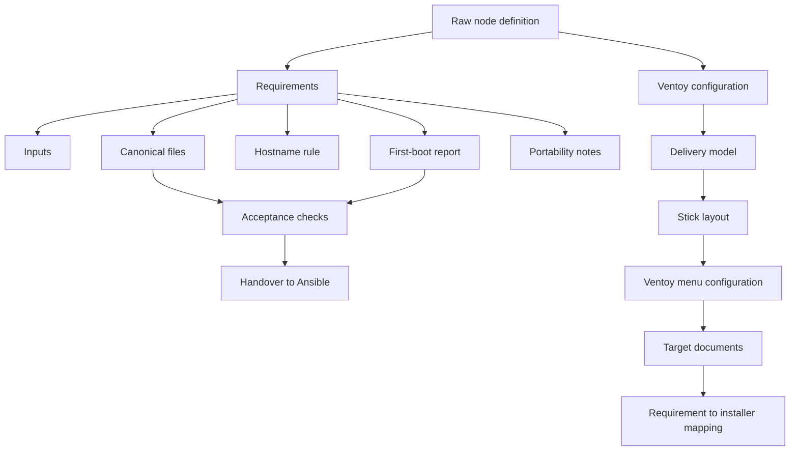

# Ventoy Raw Node Baseline



Some renderers, including GitHub, disable clicks inside Mermaid charts. The same sections are linked here: [Raw node definition](#raw-node-definition), [Requirements](#requirements), [Inputs](#inputs), [Canonical files](#canonical-files), [Hostname rule](#hostname-rule), [First-boot report](#first-boot-report), [Portability notes](#portability-notes), [Acceptance checks](#acceptance-checks), [Handover to Ansible](#handover-to-ansible), [Ventoy configuration](#ventoy-configuration), [Delivery model](#delivery-model), [Stick layout](#stick-layout), [Ventoy menu configuration](#ventoy-menu-configuration), [Target documents](#target-documents), [Requirement to installer mapping](#requirement-to-installer-mapping), [Change log](#change-log), [References](#references).

This document has two parts. [Raw node definition](#raw-node-definition) states what every freshly installed node must look like, whatever the distribution. [Ventoy configuration](#ventoy-configuration) explains how one Ventoy USB drive delivers that definition to each installer. The target documents hold what is specific to one distribution. The files themselves live in the repository and are linked rather than copied here, so the documents cannot drift from what is actually installed.

## Raw node definition

### Purpose

A raw node is the state of a machine after the operating system installer finishes and before Ansible runs for the first time. It is deliberately small: just enough to make the node reachable and safe, so that Ansible can take over and build the definitive state.

The rule that decides what belongs here: if Ansible would have to manage a setting anyway, it does not belong in the raw node.

### Requirements

Every target document must satisfy each requirement below and show how in a requirement coverage table.

| ID | Requirement |
| --- | --- |
| RN-01 | A hostname following the [Hostname rule](#hostname-rule). |
| RN-02 | Locale `en_CA.UTF-8`, keyboard `us`, time zone `America/Toronto`, network time enabled. |
| RN-03 | A `root` account with a local password, set from a hash. Root cannot log in over SSH. |
| RN-04 | An initial user, named by the input (default `initial`), with a password set from a hash, in the distribution's administrative group so it can use `sudo`. |
| RN-05 | The operator's SSH public key in the initial user's `~/.ssh/authorized_keys`, directory mode `0700`, file mode `0600`, both owned by that user. |
| RN-06 | The OpenSSH server installed and listening at boot, whether as a service or through socket activation. |
| RN-07 | The canonical SSH policy drop-in, byte for byte, taking precedence over any other SSH configuration on the node. |
| RN-08 | `nftables` installed, the canonical bootstrap ruleset byte for byte, loaded at boot, and no other firewall manager active. |
| RN-09 | `python3` installed, because Ansible needs Python on the managed node. |
| RN-10 | Storage chosen interactively during installation, until a reliable disk identifier is specified. |
| RN-11 | No plaintext passwords and no private keys anywhere on the installation media. |
| RN-12 | The [First-boot report](#first-boot-report) installed and enabled, so that the node writes `/var/lib/raw-node/confirmation.yml` once at first boot. |

The important distinction is that **the firewall allows SSH traffic; SSH then decides whether the connection authenticates with a key or a password.**

### Inputs

A raw node needs four values and nothing else. They live in `raw-node-input.yml` at the repository root, which is git-ignored because it holds password hashes. [`raw-node-input.example.yml`](../../raw-node-input.example.yml) documents the format.

| Key | Meaning |
| --- | --- |
| `root_password_hash` | Crypt hash for `root` (RN-03) |
| `initial_username` | Name of the initial user (RN-04) |
| `initial_password_hash` | Crypt hash for the initial user (RN-04) |
| `ssh_public_key` | One OpenSSH public key line (RN-05) |

Generate each hash with `mkpasswd --method=sha-512` (package `whois`). Everything else is a constant of the baseline, and the distribution is chosen from the Ventoy menu at boot. `bin/build` rejects missing, malformed or dummy values before anything is rendered.

### Canonical files

These files are written identically on every raw node. `bin/build` embeds them in each answer file and then extracts them again to prove they arrive byte for byte with the right permissions.

| Source in the repository | Path on the node | Mode |
| --- | --- | --- |
| [`shared/ssh/10-local-auth.conf`](../../shared/ssh/10-local-auth.conf) | `/etc/ssh/sshd_config.d/10-local-auth.conf` | `0644` |
| [`shared/nftables/nftables.conf`](../../shared/nftables/nftables.conf) | `/etc/nftables.conf` on Debian and Ubuntu | `0755` |
| [`shared/bin/raw-node-report`](../../shared/bin/raw-node-report) | `/usr/local/sbin/raw-node-report` | `0755` |
| [`shared/bin/raw-node-firstboot`](../../shared/bin/raw-node-firstboot) | `/usr/local/sbin/raw-node-firstboot` | `0755` |
| [`shared/systemd/raw-node-firstboot.service`](../../shared/systemd/raw-node-firstboot.service) | `/etc/systemd/system/raw-node-firstboot.service` | `0644` |
| Generated by `bin/build` | `/etc/raw-node/raw-node.conf` (user name, target, baseline version) | `0644` |
| [`shared/cloud-init/99-raw-node.cfg`](../../shared/cloud-init/99-raw-node.cfg), cloud-init targets only | `/etc/cloud/cloud.cfg.d/99-raw-node.cfg` | `0644` |

#### SSH policy

The drop-in disables root login over SSH, and enables key and password authentication for the initial user through PAM. The `10-` prefix matters. For each keyword, `sshd` uses the first value it reads <a id="cite-openbsd-sshd-config"></a>([OpenBSD, n.d.](#ref-openbsd-sshd-config)). On distributions that include `sshd_config.d/*.conf` at the top of the main file, a drop-in that sorts early wins over both the main file and any later drop-ins, such as one written by cloud-init. Each target document confirms that this holds for its distribution.

#### Bootstrap firewall

The ruleset allows new inbound connections on port 22 only. It also accepts loopback traffic, replies to connections the node itself opened (package downloads, DNS), ICMP and ICMPv6, and DHCPv6 replies. None of these opens a new way in. Forwarded traffic is dropped.

A DHCPv6 client sends its request to a multicast address and the server answers by unicast, so connection tracking does not treat the answer as part of an existing connection. The DHCPv6 rule keeps hosts on DHCPv6 networks from losing their IPv6 address. Hosts that use SLAAC only are already covered by the ICMPv6 rule.

The ruleset starts with `flush ruleset`, which clears every table in the kernel, including tables that Foomuuri, Incus or Docker create. That is acceptable for a bootstrap file that runs before anything else is installed, but it is why `nftables.service` must be disabled when Ansible hands the firewall to Foomuuri. The bootstrap firewall stays in place until then, because each raw node has SSH password authentication enabled.

#### Embedding rules

The canonical files must contain no single quotes, no line ending in a backslash and no line reading `EOF`. The Debian answer file writes them with `printf`, one single-quoted argument per line, and the Ubuntu answer files write them with quoted heredocs. `bin/build` enforces these rules.

### Hostname rule

The installer sets `<prefix>-vt`, where the prefix comes from the target folder: `deb13-vt` for `debian/13`, `ub2404-vt` for `ubuntu/24.04`, `ub2604-vt` for `ubuntu/26.04`. At first boot, `raw-node-firstboot` appends the last four hexadecimal digits of the MAC address of the interface that holds the default route, for example `deb13-vt-a1b2`, and updates `/etc/hosts`. One USB drive can therefore build any number of nodes without their names colliding. Ansible assigns the final name later.

### First-boot report

`raw-node-firstboot.service` runs once, after the network is online. It applies the [Hostname rule](#hostname-rule), runs `raw-node-report`, writes the result to `/var/lib/raw-node/confirmation.yml` and shows it at the console login prompt through `/etc/issue.d/50-raw-node.issue`. It does not run again once `confirmation.yml` exists.

```yaml
deb13-vt-a1b2:
  timestamp: 2026-11-14T13:47:00-05:00
  ip: 192.0.2.10
  ip6:
  user: initial
  sudo: true
```

Every value is measured on the node, not copied from the input: the addresses come from the default routes, `user` is filled only if the account exists, and `sudo` reflects what sudo itself reports. `sudo raw-node-report` prints the same report at any time. The report converts one to one into an Ansible inventory entry: the top-level key is the host, `ip` becomes `ansible_host` and `user` becomes `ansible_user`.

### Portability notes

The requirements are written so that they can hold on any Linux distribution. How each one is met is not. These are the differences known so far. A target document is written for a distribution only once its implementation has been checked.

| Concern | Debian and Ubuntu | Expected on Fedora and Rocky, to be verified |
| --- | --- | --- |
| Administrative group (RN-04) | `sudo` | `wheel` |
| SSH unit (RN-06) | `ssh.service` on Debian, `ssh.socket` on Ubuntu | `sshd.service` |
| `nftables` file (RN-08) | `/etc/nftables.conf` | `/etc/sysconfig/nftables.conf` |
| Competing firewall manager (RN-08) | `ufw` on Ubuntu, installed but inactive | `firewalld`, active by default, must be disabled |
| Installer | Debian Installer preseed, Subiquity autoinstall | Anaconda kickstart |

If a distribution cannot meet a requirement as written, the requirement is reviewed here rather than worked around in one target document.

### Acceptance checks

These checks confirm the raw node. Run them before the first Ansible run. The target documents add distribution-specific checks.

```sh
cat /var/lib/raw-node/confirmation.yml
systemctl status raw-node-firstboot

sudo passwd -S root

sudo sshd -t
sudo sshd -T | grep -E \
  '^(permitrootlogin|passwordauthentication|pubkeyauthentication|kbdinteractiveauthentication) '

sudo nft list ruleset
systemctl is-enabled nftables

python3 --version

sha256sum /etc/ssh/sshd_config.d/10-local-auth.conf /etc/nftables.conf \
    /usr/local/sbin/raw-node-report /usr/local/sbin/raw-node-firstboot
```

`confirmation.yml` should show `sudo: true` and the node's addresses. `passwd -S root` should report `P`, meaning root has a usable password. The `sha256sum` output must be identical on every raw node, whatever its distribution.

From another machine:

```sh
# Public key
ssh -o PreferredAuthentications=publickey initial@NODE_IP

# Password
ssh -o PreferredAuthentications=password \
    -o PubkeyAuthentication=no initial@NODE_IP

# Root must be refused
ssh -o PreferredAuthentications=password \
    -o PubkeyAuthentication=no root@NODE_IP
```

Finally, reboot once and repeat `sudo nft list ruleset` to confirm the firewall loads at boot rather than only during installation.

### Handover to Ansible

#### Division of responsibility

| Stage | Responsible for |
| --- | --- |
| Ventoy | Carrying each ISO and its answer file to the installer. Ventoy creates no configuration itself. |
| Answer files | The raw node, as defined by the requirements above. |
| Ansible | The definitive state: the Foomuuri firewall, the final SSH policy, packages, users, roles such as an Incus host, and everything else that must match across nodes. |

Homogeneity across nodes comes from Ansible running the same roles everywhere and continuing to enforce them after the first day, which an installer cannot do. The answer files only need to guarantee what Ansible relies on to connect: the initial user with `sudo`, the SSH key, Python, and port 22 reachable.

#### Replacing the bootstrap firewall with Foomuuri

The bootstrap ruleset starts with `flush ruleset`, which clears every table, chain, rule and set in the kernel <a id="cite-canonical-nftables"></a>([Canonical, n.d.](#ref-canonical-nftables)). That includes Foomuuri's rules, so `nftables.service` must not stay enabled once Foomuuri takes over. The Ansible play should follow this order:

1. Install `foomuuri`, deploy the configuration templates and run `foomuuri check` before anything is applied.
2. Enable and start Foomuuri, then confirm that a new SSH connection still succeeds.
3. Remove the bootstrap table with `nft delete table inet filter` and disable the old loader with `systemctl disable nftables`. Optionally replace the bootstrap file with a stub that contains no `flush ruleset`, so a stray restart cannot remove Foomuuri's rules.
4. Reboot once and confirm with `nft list tables` that only Foomuuri's table remains.

Steps 2 and 3 are ordered so that both tables exist briefly. A packet must then be accepted by both, which makes the overlap stricter rather than looser. Access is lost only if the Foomuuri configuration itself drops SSH. For the first rollout, schedule a timed rollback before the cutover, for example with `systemd-run --on-active=5m` re-enabling the bootstrap rules, and cancel it once Ansible reconnects. Alternatively, run the first cutover on an Incus virtual machine with console access.

On hosts that will run Incus or Docker, complete the Foomuuri handover before or together with installing them. Those tools add their own `nftables` tables, and the bootstrap `flush ruleset` would remove them on any restart of `nftables.service`.

#### Foomuuri versions

The packaged Foomuuri version differs by distribution:

| Release | Package |
| --- | --- |
| Ubuntu 24.04 | 0.22, universe component <a id="cite-ubuntu-packages-foomuuri"></a>([Ubuntu, n.d.](#ref-ubuntu-packages-foomuuri)) |
| Debian 13 | 0.27, with 0.31 in trixie-backports <a id="cite-debian-sources-foomuuri"></a>([Debian Project, n.d.](#ref-debian-sources-foomuuri)) |
| Ubuntu 26.04 | Check the archive before writing the role |

One Ansible template may not behave the same on 0.22 and 0.31. Either pin one version on every node (backports on Debian, an upstream or locally built package on Ubuntu), or write the configuration against the oldest version deployed and test it on each release. On Ubuntu, the universe component receives community rather than Canonical security maintenance, so confirm that security fixes have reached the version in use.

On servers, do not install `foomuuri-firewalld` or enable the D-Bus service. Zone switching driven by NetworkManager is only useful on desktops.

#### Optional tighter bootstrap

A stricter variant would install with key-only SSH (`PasswordAuthentication no` in the drop-in, and `allow-pw: false` on Ubuntu), and let Ansible enable password authentication once Foomuuri is in place. This removes password logins from the window between first boot and the first Ansible run. It is not adopted in this version, because the raw node as specified includes password authentication from the start.

## Ventoy configuration

### Delivery model

Ventoy does not create any part of the raw node. It boots the selected ISO and hands the installer an answer file, which Ventoy calls a template. The answer file builds the raw node using each installer's own mechanism: `late_command` in a Debian preseed file, `late-commands` in Ubuntu autoinstall. The mechanisms differ, but the files they write are the canonical files, byte for byte.

`bin/build` runs on the workstation, renders one answer file per target from `<distro>/<version>/*.j2`, and with `--stick` writes only its output to the Ventoy drive. ISOs are verified where they are stored, before they are copied to the drive, with `bin/check-isos`. See [ISO downloads](iso-downloads.md).

### Stick layout

On the Ventoy data partition, answer files mirror the ISO folders:

```text
/
├── iso/
│   ├── debian/13/debian-13.7.0-amd64-netinst.iso
│   └── ubuntu/
│       ├── 24.04/ubuntu-24.04.5-live-server-amd64.iso
│       └── 26.04/ubuntu-26.04.1-live-server-amd64.iso
├── answer-files/
│   ├── debian/13/preseed.cfg
│   └── ubuntu/
│       ├── 24.04/user-data
│       └── 26.04/user-data
└── ventoy/
    └── ventoy.json
```

Keep one ISO in each version folder. Swapping in a new point release needs no rebuild, because Ventoy matches the folder rather than the file.

### Ventoy menu configuration

`bin/build` writes these entries into `/ventoy/ventoy.json`. It backs up the file first and replaces only the raw node entries, keeping every other setting and menu entry.

```json
{
  "auto_install": [
    { "parent": "/iso/debian/13",    "template": "/answer-files/debian/13/preseed.cfg" },
    { "parent": "/iso/ubuntu/24.04", "template": "/answer-files/ubuntu/24.04/user-data" },
    { "parent": "/iso/ubuntu/26.04", "template": "/answer-files/ubuntu/26.04/user-data" }
  ]
}
```

`auto_install` maps each ISO, or a whole parent directory, to one or more answer files, and `autosel` can preselect one of them <a id="cite-ventoy-autoinstall"></a>([Ventoy, n.d.](#ref-ventoy-autoinstall)). `autosel` is deliberately omitted. Ventoy then asks at boot whether to use an answer file, which protects against accidentally starting an unattended installation.

Because one folder can carry several answer files, role variants do not need a second ISO. A planned Debian 13 Incus host variant would become a second answer file for `/iso/debian/13` once its partitioning is automated. Until then, the role is given by Ansible.

### Target documents

| Distribution | Installer | Document | Metal | VM | Status |
| --- | --- | --- | --- | --- | --- |
| Debian 13 "trixie" | Debian Installer, preseed | [debian-13.md](debian-13.md) | Passed 2026-11-15 | Not yet | Supported, reference node |
| Ubuntu Server 24.04 LTS | Subiquity, autoinstall | [ubuntu-24.04.md](ubuntu-24.04.md) | Not yet | Not yet | In testing |
| Ubuntu Server 26.04 LTS | Subiquity, autoinstall | [ubuntu-26.04.md](ubuntu-26.04.md) | Not yet | Not yet | In testing |
| Fedora Server, Rocky Linux | Anaconda, kickstart | Not started | No | No | Planned, see [Portability notes](#portability-notes) |

Target documents are added one distribution at a time. A distribution counts as supported once its acceptance checks pass and its `sha256sum` output matches the other raw nodes.

### Requirement to installer mapping

| ID | Debian preseed | Ubuntu autoinstall |
| --- | --- | --- |
| RN-01 | `netcfg/hostname`, then `raw-node-firstboot` | `identity.hostname`, then `raw-node-firstboot` |
| RN-02 | `debian-installer/locale`, `keyboard-configuration/xkb-keymap`, `time/zone`, `clock-setup/ntp` | `locale`, `keyboard`, `timezone` |
| RN-03 | `passwd/root-password-crypted` | `usermod --password` in `late-commands` |
| RN-04 | `passwd/user-password-crypted`, `usermod -aG sudo` in `late_command` | `identity` (default groups include `sudo`) |
| RN-05 | `late_command` | `ssh.authorized-keys` |
| RN-06 | `tasksel` `ssh-server` | `ssh.install-server` |
| RN-07 | `late_command`, `printf` | `late-commands`, heredoc |
| RN-08 | `pkgsel/include`, `late_command`, `systemctl enable nftables` | `packages`, `late-commands`, `systemctl enable nftables` |
| RN-09 | `pkgsel/include` | `packages` |
| RN-10 | Partitioning not preseeded | `interactive-sections: [storage]` |
| RN-11 | Hashes only | Hashes only |
| RN-12 | `late_command`, `systemctl enable raw-node-firstboot` | `late-commands`, `systemctl enable raw-node-firstboot` |

### Qualification

These are reviewed configuration templates, not yet a tested turnkey installer. Validate each target in an Incus virtual machine before using it on physical hardware, especially account creation, the root password, the SSH configuration, firewall activation at boot and the first-boot report.

## Change log

### 0.3.0, 2026-11-14

- Aligned with the uc-ventoy generator: inputs, `bin/build`, `bin/check-isos`, and the stick layout with `/iso` and `/answer-files` folders matched by parent directory.
- Replaced copies of the canonical files with links to the repository, plus a table of where each file lands.
- Added the [Hostname rule](#hostname-rule) to RN-01, made the initial user name an input in RN-04 and RN-05, and added RN-12 for the first-boot report.
- Replaced base64 embedding with `printf` for Debian, and documented the embedding rules.
- Removed the Maintained implementation section, now covered by the repository README.
- Renamed from `ventoy-raw-node-baseline-v0.2.0.md`; versions are tracked in the front matter.

### Earlier versions

- 0.2.0: split the distro-agnostic content out of the combined Debian and Ubuntu document and introduced the numbered requirements.
- 0.1.0 to 0.1.2: Debian and Ubuntu covered together in one combined document.

## References

<a id="ref-canonical-nftables"></a>
Canonical. (n.d.). *nftables*. Ubuntu security documentation. Retrieved November 14, 2026, from https://documentation.ubuntu.com/security/security-features/network/firewall/nftables/
[Return to citation](#cite-canonical-nftables)

<a id="ref-debian-sources-foomuuri"></a>
Debian Project. (n.d.). *Package: foomuuri*. Debian sources. Retrieved November 14, 2026, from https://sources.debian.org/patches/foomuuri
[Return to citation](#cite-debian-sources-foomuuri)

<a id="ref-openbsd-sshd-config"></a>
OpenBSD. (n.d.). *sshd_config(5): OpenSSH daemon configuration file*. OpenBSD manual pages. Retrieved November 14, 2026, from https://man.openbsd.org/sshd_config
[Return to citation](#cite-openbsd-sshd-config)

<a id="ref-ubuntu-packages-foomuuri"></a>
Ubuntu. (n.d.). *Package: foomuuri (0.22-1) [universe], noble (24.04LTS)*. Ubuntu packages. Retrieved November 14, 2026, from https://packages.ubuntu.com/noble/foomuuri
[Return to citation](#cite-ubuntu-packages-foomuuri)

<a id="ref-ventoy-autoinstall"></a>
Ventoy. (n.d.). *Auto installation plugin*. Retrieved November 14, 2026, from https://www.ventoy.net/en/plugin_autoinstall.html
[Return to citation](#cite-ventoy-autoinstall)
