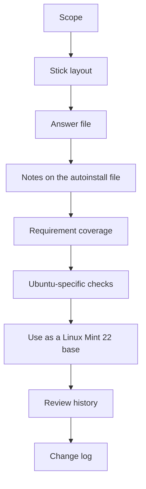

# Ventoy Automated Configuration for Ubuntu 24.04 Server



Some renderers, including GitHub, disable clicks inside Mermaid charts. The same sections are linked here: [Scope](#scope), [Stick layout](#stick-layout), [Answer file](#answer-file), [Notes on the autoinstall file](#notes-on-the-autoinstall-file), [Requirement coverage](#requirement-coverage), [Ubuntu-specific checks](#ubuntu-specific-checks), [Use as a Linux Mint 22 base](#use-as-a-linux-mint-22-base), [Review history](#review-history), [Change log](#change-log), [References](#references).

## Scope

- Ubuntu Server 24.04 LTS "Noble Numbat", installed with Subiquity and cloud-init autoinstall from the 24.04.5 installation media, released on September 10, 2026 <a id="cite-gupta-2026"></a>([Gupta, 2026](#ref-gupta-2026)). Ubuntu Server 24.04 receives maintenance updates for five years from its April 2024 release <a id="cite-jacquet-2026"></a>([Jacquet, 2026](#ref-jacquet-2026)).
- The result is the raw node defined in [raw-node-baseline.md](raw-node-baseline.md), which holds the requirements (RN-01 to RN-12), the inputs, the canonical files, the general acceptance checks and the handover to Ansible. This document holds only what is specific to Ubuntu 24.04.
- The installer hostname is `ub2404-vt`, which becomes `ub2404-vt-xxxx` at first boot.
- A node built from this document can also serve as the base for a Linux Mint 22 desktop. See [Use as a Linux Mint 22 base](#use-as-a-linux-mint-22-base).

## Stick layout

```text
/iso/ubuntu/24.04/ubuntu-24.04.5-live-server-amd64.iso
/answer-files/ubuntu/24.04/user-data
```

`bin/build --stick` writes the answer file and the `ventoy.json` entry, which matches the folder `/iso/ubuntu/24.04` rather than the ISO filename. See [ISO downloads](iso-downloads.md) for fetching and verifying the ISO.

The 24.04.5 server ISO offers both the general availability kernel (6.8) and the hardware enablement (HWE) kernel, which in 24.04.5 is based on Linux 7.0 <a id="cite-larabel-2026"></a>([Larabel, 2026](#ref-larabel-2026)). Either serves the raw node. The general availability kernel changes less over the life of the release, and the HWE kernel supports newer hardware. A host that will run Incus 7.0 needs kernel 6.12 or later <a id="cite-linuxiac-incus-7"></a>([Linuxiac, 2026](#ref-linuxiac-incus-7)), so choose the HWE kernel for that role.

## Answer file

Template: [`ubuntu/24.04/user-data.j2`](../../ubuntu/24.04/user-data.j2). `bin/build` renders it into `build/answer-files/ubuntu/24.04/user-data`, filling in the [inputs](raw-node-baseline.md#inputs) and embedding the [canonical files](raw-node-baseline.md#canonical-files).

The `autoinstall` section sets locale, keyboard and time zone, keeps storage interactive, creates the initial user through `identity`, installs the OpenSSH server with the key and password authentication through `ssh`, and adds `nftables` and `python3`. Its `late-commands` write each canonical file with a quoted heredoc, set the root password and enable `nftables.service` and `raw-node-firstboot.service`.

The template matches the Ubuntu 26.04 one except for the root password command, which is written as a single-quoted string rather than a list so that it does not depend on newer Subiquity behaviour. Both forms set the same password.

## Notes on the autoinstall file

A `late-commands` entry written as a string runs through `sh -c`, with the new system mounted at `/target` <a id="cite-canonical-autoinstall-reference"></a>([Canonical, n.d.-a](#ref-canonical-autoinstall-reference)). The file-writing entries use YAML block scalars, so the heredocs reach the shell with their indentation stripped and the files come out identical to the canonical versions. The root password hash is wrapped in single quotes so the shell does not expand its `$` characters. A crypt hash never contains a single quote, so this is safe.

The same reference explains the rest of the file:

- Users in `identity` are created during installation, while users in `user-data` are created on first boot. Setting the root password in `late-commands` keeps it with the rest of the install.
- `identity` is not given a `groups` key. The default groups already include `sudo`, and a plain list would replace them.
- `allow-pw` defaults to `false` when `authorized-keys` is present, so `allow-pw: true` must stay explicit.
- `authorized-keys` installs the key for the initial user, so no manual `authorized_keys` handling is needed.

`hostname` exists only inside `identity`, and `identity` rejects any key it does not define <a id="cite-canonical-autoinstall-schema"></a>([Canonical, n.d.-b](#ref-canonical-autoinstall-schema)). Do not add a top-level `hostname`.

The installer writes `/etc/ssh/sshd_config.d/50-cloud-init.conf` with its own `PasswordAuthentication` line <a id="cite-launchpad-2088207"></a>([Launchpad, 2024](#ref-launchpad-2088207)). Because Ubuntu includes `sshd_config.d/*.conf` at the top of `sshd_config` and `10-local-auth.conf` sorts first, the canonical drop-in wins, as RN-07 requires.

The answer file also writes `/etc/cloud/cloud.cfg.d/99-raw-node.cfg` with `preserve_hostname: true`, so that cloud-init does not reset the suffixed hostname that `raw-node-firstboot` sets.

Since Ubuntu 22.10, OpenSSH starts through `ssh.socket` rather than a permanently running `ssh.service`, and 24.04 follows that default <a id="cite-ubuntu-ssh-socket"></a>([Ubuntu Community Hub, n.d.](#ref-ubuntu-ssh-socket)). The file therefore does not enable `ssh.service`. `ufw` is installed on Ubuntu Server but inactive. Leave it inactive so that `nftables` is the only firewall manager, as RN-08 requires.

`python3` is part of Ubuntu Server already. It is listed in `packages` so that RN-09 is explicit in the answer file.

The Subiquity documentation cited here is the current version. Subiquity can refresh itself at the start of an installation when the machine has network access, so the version that actually runs may be newer than the one on the 24.04.5 ISO. Every key used above has been part of autoinstall since well before 24.04.

## Requirement coverage

| ID | How this answer file meets it |
| --- | --- |
| RN-01 | `identity.hostname` set to `ub2404-vt`; suffix added by `raw-node-firstboot`; kept by `preserve_hostname` |
| RN-02 | `locale`, `keyboard`, `timezone`; network time through `systemd-timesyncd`, enabled by default |
| RN-03 | `usermod --password` in `late-commands`; root SSH login refused by the drop-in |
| RN-04 | `identity.username` and `identity.password`; default groups include `sudo` |
| RN-05 | `ssh.authorized-keys` |
| RN-06 | `ssh.install-server`; listening through `ssh.socket` |
| RN-07 | Heredoc writes `/etc/ssh/sshd_config.d/10-local-auth.conf`, which sorts before `50-cloud-init.conf` |
| RN-08 | `nftables` in `packages`; heredoc writes `/etc/nftables.conf`; `systemctl enable nftables.service`; `ufw` stays inactive |
| RN-09 | `python3` in `packages` |
| RN-10 | `interactive-sections: [storage]` |
| RN-11 | Only crypt hashes and the public key appear in the file |
| RN-12 | Heredocs write the report scripts, unit and `raw-node.conf`; `systemctl enable raw-node-firstboot.service` |

## Ubuntu-specific checks

Run the baseline [acceptance checks](raw-node-baseline.md#acceptance-checks), then:

```sh
lsb_release -d
systemctl status ssh.socket
sudo ufw status
ls /etc/ssh/sshd_config.d/
hostnamectl --static
```

`lsb_release -d` should report Ubuntu 24.04. `ssh.socket` should be active and enabled. `ssh.service` may show as inactive until the first connection arrives, which is expected with socket activation. `ufw status` should report `inactive`. `10-local-auth.conf` should be listed before `50-cloud-init.conf`. The hostname should be `ub2404-vt-` followed by four hexadecimal digits, and should survive a reboot.

## Use as a Linux Mint 22 base

Linux Mint 22 is built on the Ubuntu 24.04 archive. Point releases only refresh the installation media, so once the node runs `apt update` it uses the same `noble` archive that Mint 22 is built on. A raw node installed from this document can therefore serve as the base for a Mint 22 desktop.

The result is not a supported Mint installation, and a later move to Mint 23, which is based on Ubuntu 26.04, should be planned as a rebuild rather than an upgrade. The desktop layer belongs in Ansible, and it needs these adjustments:

- Switch netplan to `renderer: NetworkManager`, otherwise the desktop shows the network as unmanaged.
- Keep Mint's `ufw` inactive or remove it, so that Foomuuri remains the only firewall manager.
- Expect apt to propose removing `snapd`, because Mint blocks it. Review the list before confirming.
- Install `foomuuri-firewalld` on the desktop, unlike on servers, so that NetworkManager can switch zones.
- cloud-init stays installed from the server install. It is harmless, and it can be turned off with `touch /etc/cloud/cloud-init.disabled` once the desktop is built.

## Review history

| Item | Status | Detail |
| --- | --- | --- |
| Answer file derived from the combined document | 0.1.1 | Same accounts, SSH policy and `nftables` ruleset as the Ubuntu 26.04 file. |
| Root password command | 0.1.1 | Single-quoted string instead of the list form. |
| Installation media | 0.1.2 | Moved from 24.04.4 to 24.04.5. |
| `python3` | 0.2.0 | Requested explicitly for RN-09. |
| Hostname | 0.3.0 | `ub2404-vt` plus a MAC suffix at first boot, replacing `ubuntu-server`. |
| First-boot report and `preserve_hostname` | 0.3.0 | RN-12. |

## Qualification

This is a reviewed configuration template, not yet a tested turnkey installer. Validate it in an Incus virtual machine with the 24.04.5 ISO before using it on physical hardware.

## Change log

### 0.3.0, 2026-11-14

- The answer file is now rendered by `bin/build` from [`ubuntu/24.04/user-data.j2`](../../ubuntu/24.04/user-data.j2) and is linked rather than copied here.
- New stick paths: `/iso/ubuntu/24.04/` and `/answer-files/ubuntu/24.04/user-data`.
- Hostname `ub2404-vt` with a first-boot MAC suffix, kept by a cloud-init `preserve_hostname` setting; added RN-12 coverage.
- Mint 22 base section: added the point-release reasoning and the cloud-init note from the session notes.
- Renamed from `ventoy-automated-configuration-for-ubuntu-24.04-server-v0.2.0.md`; versions are tracked in the front matter.

### Earlier versions

- 0.2.0: distro-agnostic content moved to the baseline, `python3` added, requirement coverage table added.
- 0.1.2: moved to the 24.04.5 installation media and added the handover to Ansible.
- 0.1.1: first release, derived from the Ubuntu section of the combined document.

## References

<a id="ref-canonical-autoinstall-reference"></a>
Canonical. (n.d.-a). *Autoinstall configuration reference manual*. Subiquity documentation. Retrieved November 14, 2026, from https://canonical-subiquity.readthedocs-hosted.com/en/latest/reference/autoinstall-reference.html
[Return to citation](#cite-canonical-autoinstall-reference)

<a id="ref-canonical-autoinstall-schema"></a>
Canonical. (n.d.-b). *Autoinstall schema*. Subiquity documentation. Retrieved November 14, 2026, from https://canonical-subiquity.readthedocs-hosted.com/en/latest/reference/autoinstall-schema.html
[Return to citation](#cite-canonical-autoinstall-schema)

<a id="ref-gupta-2026"></a>
Gupta, U. (2026, September 10). *Ubuntu 24.04.5 LTS released* [Online forum post]. Ubuntu Community Hub. https://discourse.ubuntu.com/t/ubuntu-24-04-5-lts-released/87608
[Return to citation](#cite-gupta-2026)

<a id="ref-jacquet-2026"></a>
Jacquet, F. (2026, February 12). *Ubuntu 24.04.4 LTS released* [Mailing list post]. ubuntu-announce. https://lists.ubuntu.com/archives/ubuntu-announce/2026-February/000321.html
[Return to citation](#cite-jacquet-2026)

<a id="ref-larabel-2026"></a>
Larabel, M. (2026, September 10). *Ubuntu 24.04.5 LTS released with Linux 7.0 HWE stack*. Phoronix. https://phoronix.com/news/Ubuntu-24.04.5-LTS
[Return to citation](#cite-larabel-2026)

<a id="ref-launchpad-2088207"></a>
Launchpad. (2024). *Bug #2088207: cloud-init enables ssh password auth in an unexpected config file*. https://bugs.launchpad.net/bugs/2088207
[Return to citation](#cite-launchpad-2088207)

<a id="ref-linuxiac-incus-7"></a>
Linuxiac. (2026). *Incus 7.0 LTS container & virtual machine manager released*. https://linuxiac.com/incus-7-0-lts-container-and-virtual-machine-manager-released/
[Return to citation](#cite-linuxiac-incus-7)

<a id="ref-ubuntu-ssh-socket"></a>
Ubuntu Community Hub. (n.d.). *sshd now uses socket-based activation (Ubuntu 22.10 and later)*. Retrieved November 14, 2026, from https://discourse.ubuntu.com/t/sshd-now-uses-socket-based-activation-ubuntu-22-10-and-later/30189
[Return to citation](#cite-ubuntu-ssh-socket)
