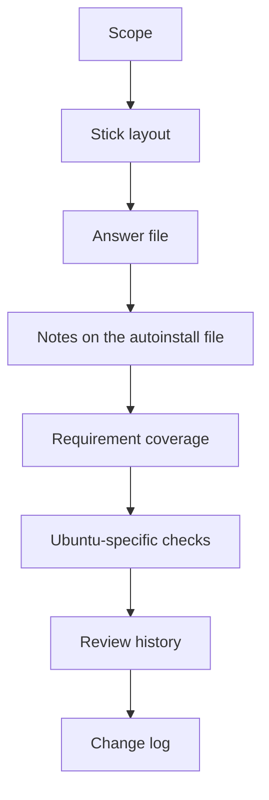

# Ventoy Automated Configuration for Ubuntu 26.04 Server



Some renderers, including GitHub, disable clicks inside Mermaid charts. The same sections are linked here: [Scope](#scope), [Stick layout](#stick-layout), [Answer file](#answer-file), [Notes on the autoinstall file](#notes-on-the-autoinstall-file), [Requirement coverage](#requirement-coverage), [Ubuntu-specific checks](#ubuntu-specific-checks), [Review history](#review-history), [Change log](#change-log), [References](#references).

## Scope

- Ubuntu Server 26.04 LTS <a id="cite-canonical-2026-release-notes"></a>([Canonical, 2026](#ref-canonical-2026-release-notes)), installed with Subiquity and cloud-init autoinstall.
- The result is the raw node defined in [raw-node-baseline.md](raw-node-baseline.md), which holds the requirements (RN-01 to RN-12), the inputs, the canonical files, the general acceptance checks and the handover to Ansible. This document holds only what is specific to Ubuntu 26.04.
- The installer hostname is `ub2604-vt`, which becomes `ub2604-vt-xxxx` at first boot.

## Stick layout

```text
/iso/ubuntu/26.04/ubuntu-26.04.1-live-server-amd64.iso
/answer-files/ubuntu/26.04/user-data
```

`bin/build --stick` writes the answer file and the `ventoy.json` entry, which matches the folder `/iso/ubuntu/26.04` rather than the ISO filename. See [ISO downloads](iso-downloads.md) for fetching and verifying the ISO.

## Answer file

Template: [`ubuntu/26.04/user-data.j2`](../../ubuntu/26.04/user-data.j2). `bin/build` renders it into `build/answer-files/ubuntu/26.04/user-data`, filling in the [inputs](raw-node-baseline.md#inputs) and embedding the [canonical files](raw-node-baseline.md#canonical-files).

The `autoinstall` section sets locale, keyboard and time zone, keeps storage interactive, creates the initial user through `identity`, installs the OpenSSH server with the key and password authentication through `ssh`, and adds `nftables`, `python3` and `foomuuri`. Its `late-commands` write each canonical file with a quoted heredoc, set the root password, mask `nftables.service` and `ufw.service`, and enable `foomuuri.service` and `raw-node-firstboot.service`.

## Notes on the autoinstall file

A `late-commands` entry written as a string runs through `sh -c`, and an entry written as a list runs directly, in both cases with the new system mounted at `/target` <a id="cite-canonical-autoinstall-reference"></a>([Canonical, n.d.-a](#ref-canonical-autoinstall-reference)). The file-writing entries use YAML block scalars, so the heredocs reach the shell with their indentation stripped and the files come out identical to the canonical versions. The root password entry uses the list form so the `$` characters in the hash never pass through a shell.

The same reference explains the rest of the file:

- Users in `identity` are created during installation, while users in `user-data` are created on first boot. Setting the root password in `late-commands` keeps it with the rest of the install.
- A plain list under `identity.groups` replaces the default groups, which already include `sudo`. Omitting `groups` keeps the defaults.
- `allow-pw` defaults to `false` when `authorized-keys` is present, so `allow-pw: true` must stay explicit.
- `authorized-keys` installs the key for the initial user, so no manual `authorized_keys` handling is needed.

`hostname` exists only inside `identity`, and `identity` rejects any key it does not define <a id="cite-canonical-autoinstall-schema"></a>([Canonical, n.d.-b](#ref-canonical-autoinstall-schema)). Do not add a top-level `hostname`.

The installer writes `/etc/ssh/sshd_config.d/50-cloud-init.conf` with its own `PasswordAuthentication` line <a id="cite-launchpad-2088207"></a>([Launchpad, 2024](#ref-launchpad-2088207)). Because Ubuntu includes `sshd_config.d/*.conf` at the top of `sshd_config` and `10-local-auth.conf` sorts first, the canonical drop-in wins, as RN-07 requires.

The answer file also writes `/etc/cloud/cloud.cfg.d/99-raw-node.cfg` with `preserve_hostname: true`, so that cloud-init does not reset the suffixed hostname that `raw-node-firstboot` sets.

Since Ubuntu 22.10, OpenSSH starts through `ssh.socket` rather than a permanently running `ssh.service` <a id="cite-ubuntu-ssh-socket"></a>([Ubuntu Community Hub, n.d.](#ref-ubuntu-ssh-socket)). The file therefore does not enable `ssh.service`. With socket activation the port belongs to `ssh.socket`, not to sshd. `sshd-socket-generator`, which the `openssh-server` package installs, reads the effective sshd configuration at every boot and writes the socket's listen addresses from it. Run against a `Port` line in `sshd_config.d`, the packaged generator produced a socket for that port, so `20-raw-node-port.conf` is enough and no socket override is written. For port 22 the generator writes nothing and the socket's own default applies.

The firewall is Foomuuri 0.31 from the `universe` component, so the installer needs network access to the archive. `foomuuri.service` loads the rules before `network-pre.target` and starts `foomuuri-boot.service` by itself, which loads the last good ruleset earlier still from the second boot on. `foomuuri-boot.service` has no install section, so it is not enabled separately. `ufw` is installed on Ubuntu Server with its service enabled, although it loads no rules. `late-commands` mask `ufw.service` and `nftables.service`, so that Foomuuri is the only firewall manager, as RN-08 requires, and nothing can flush its table.

The answer file also writes `/etc/systemd/system/foomuuri.service.d/10-raw-node.conf`, which turns off the default dependencies of `foomuuri.service`. On 26.04 cloud-init no longer orders itself after the network, and a check of the packaged unit files finds no ordering cycle even without the drop-in. cloud-init can still wait for the network itself while `sysinit.target` is held back, which would block a Foomuuri that waits for `sysinit.target`, so the drop-in is written here too. See [contracts.md](contracts.md#notes-on-the-firewall-clauses).

`python3` is part of Ubuntu Server already. It is listed in `packages` so that RN-09 is explicit in the answer file.

## Requirement coverage

| ID | How this answer file meets it |
| --- | --- |
| RN-01 | `identity.hostname` set to `ub2604-vt`; suffix added by `raw-node-firstboot`; kept by `preserve_hostname` |
| RN-02 | `locale`, `keyboard`, `timezone`; network time is enabled by default in Ubuntu Server |
| RN-03 | `usermod --password` in `late-commands`; root SSH login refused by the drop-in |
| RN-04 | `identity.username` and `identity.password`; default groups include `sudo` |
| RN-05 | `ssh.authorized-keys` |
| RN-06 | `ssh.install-server`; listening through `ssh.socket`, on the port `sshd-socket-generator` reads from `20-raw-node-port.conf` |
| RN-07 | Heredocs write `/etc/ssh/sshd_config.d/10-local-auth.conf`, which sorts before `50-cloud-init.conf`, and `20-raw-node-port.conf` |
| RN-08 | `foomuuri` in `packages`; heredocs write `/etc/foomuuri/00-raw-node.conf` and the `foomuuri.service` drop-in; `systemctl mask nftables.service ufw.service`; `systemctl enable foomuuri.service` |
| RN-09 | `python3` in `packages` |
| RN-10 | `interactive-sections: [storage]` |
| RN-11 | Only crypt hashes and the public key appear in the file |
| RN-12 | Heredocs write the report scripts, unit and `raw-node.conf`; `systemctl enable raw-node-firstboot.service` |

## Ubuntu-specific checks

Run the baseline [acceptance checks](raw-node-baseline.md#acceptance-checks), then:

```sh
systemctl status ssh.socket
systemctl cat ssh.socket
systemctl is-enabled ufw nftables
systemctl status foomuuri
systemctl cat foomuuri
cloud-init status --long
journalctl -b | grep -i -E 'ordering cycle|deleted to break'
ls /etc/ssh/sshd_config.d/
hostnamectl --static
```

`ssh.socket` should be active and enabled. `ssh.service` may show as inactive until the first connection arrives, which is expected with socket activation. When `ssh_port` is not 22, `systemctl cat ssh.socket` should show a generated drop-in with that port. `ufw` and `nftables` should both be `masked`. `foomuuri.service` should be active, and `systemctl cat foomuuri` should show the `10-raw-node.conf` drop-in. `cloud-init status` should report `done` without errors, and the journal search should print nothing. `10-local-auth.conf` should be listed before `20-raw-node-port.conf` and `50-cloud-init.conf`. The hostname should be `ub2604-vt-` followed by four hexadecimal digits, and should survive a reboot.

## Review history

| Item | Status | Detail |
| --- | --- | --- |
| Top-level `hostname` | Removed in 0.1.1 | Not a valid autoinstall key. |
| `identity.groups` | Removed in 0.1.1 | A plain list replaces the default groups, and `sudo` is already a default. |
| Root password through `user-data.users` | Changed in 0.1.1 | Replaced with `usermod --password` in `late-commands`. |
| `authorized_keys` written by hand | Removed in 0.1.1 | `ssh.authorized-keys` already installs the key. |
| SSH and `nftables` files | Added in 0.1.1 | The 0.1.0 `late-commands` never wrote them. |
| `ssh.service` enable | Removed in 0.1.1 | Ubuntu uses socket activation. |
| `python3` | Added in 0.2.0 | Requested explicitly for RN-09. |
| Hostname | Changed in 0.3.0 | `ub2604-vt` plus a MAC suffix at first boot, replacing `ubuntu-server`. |
| First-boot report and `preserve_hostname` | Added in 0.3.0 | RN-12. |
| Firewall | Replaced in 0.3.0 | Foomuuri with `/etc/foomuuri/00-raw-node.conf` instead of `/etc/nftables.conf`. `nftables.service` and `ufw.service` masked. Drop-in for `foomuuri.service`. |
| SSH port | Added in 0.3.0 | `20-raw-node-port.conf`, from the `ssh_port` input. |

## Qualification

This is a reviewed configuration template, not yet a tested turnkey installer. Validate it in an Incus virtual machine before using it on physical hardware.

## Change log

### 0.3.0, 2026-11-15

- Firewall changed to Foomuuri 0.31: `foomuuri` added to the packages, `/etc/foomuuri/00-raw-node.conf` written instead of `/etc/nftables.conf`, `nftables.service` and `ufw.service` masked, `foomuuri.service` enabled.
- A drop-in for `foomuuri.service` keeps it out of an ordering cycle with cloud-init.
- SSH port drop-in written from the `ssh_port` input, followed by `ssh.socket` through `sshd-socket-generator`.
- The confirmation follows the raw node contract 0.1.0. See [contracts.md](contracts.md).

### 0.3.0, 2026-11-14

- The answer file is now rendered by `bin/build` from [`ubuntu/26.04/user-data.j2`](../../ubuntu/26.04/user-data.j2) and is linked rather than copied here.
- New stick paths: `/iso/ubuntu/26.04/` and `/answer-files/ubuntu/26.04/user-data`.
- Hostname `ub2604-vt` with a first-boot MAC suffix, kept by a cloud-init `preserve_hostname` setting; added RN-12 coverage.
- Renamed from `ventoy-automated-configuration-for-ubuntu-26.04-server-v0.2.0.md`; versions are tracked in the front matter.

### Earlier versions

- 0.2.0: split from the combined document, `python3` added, requirement coverage table added.
- 0.1.0 to 0.1.2: Debian and Ubuntu covered together in one combined document.

## References

<a id="ref-canonical-autoinstall-reference"></a>
Canonical. (n.d.-a). *Autoinstall configuration reference manual*. Subiquity documentation. Retrieved November 14, 2026, from https://canonical-subiquity.readthedocs-hosted.com/en/latest/reference/autoinstall-reference.html
[Return to citation](#cite-canonical-autoinstall-reference)

<a id="ref-canonical-autoinstall-schema"></a>
Canonical. (n.d.-b). *Autoinstall schema*. Subiquity documentation. Retrieved November 14, 2026, from https://canonical-subiquity.readthedocs-hosted.com/en/latest/reference/autoinstall-schema.html
[Return to citation](#cite-canonical-autoinstall-schema)

<a id="ref-canonical-2026-release-notes"></a>
Canonical. (2026, April 23). *Ubuntu 26.04 LTS release notes*. https://documentation.ubuntu.com/release-notes/26.04/
[Return to citation](#cite-canonical-2026-release-notes)

<a id="ref-launchpad-2088207"></a>
Launchpad. (2024). *Bug #2088207: cloud-init enables ssh password auth in an unexpected config file*. https://bugs.launchpad.net/bugs/2088207
[Return to citation](#cite-launchpad-2088207)

<a id="ref-ubuntu-ssh-socket"></a>
Ubuntu Community Hub. (n.d.). *sshd now uses socket-based activation (Ubuntu 22.10 and later)*. Retrieved November 14, 2026, from https://discourse.ubuntu.com/t/sshd-now-uses-socket-based-activation-ubuntu-22-10-and-later/30189
[Return to citation](#cite-ubuntu-ssh-socket)
